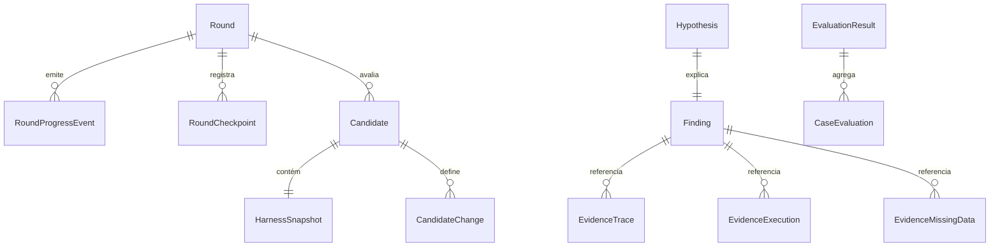
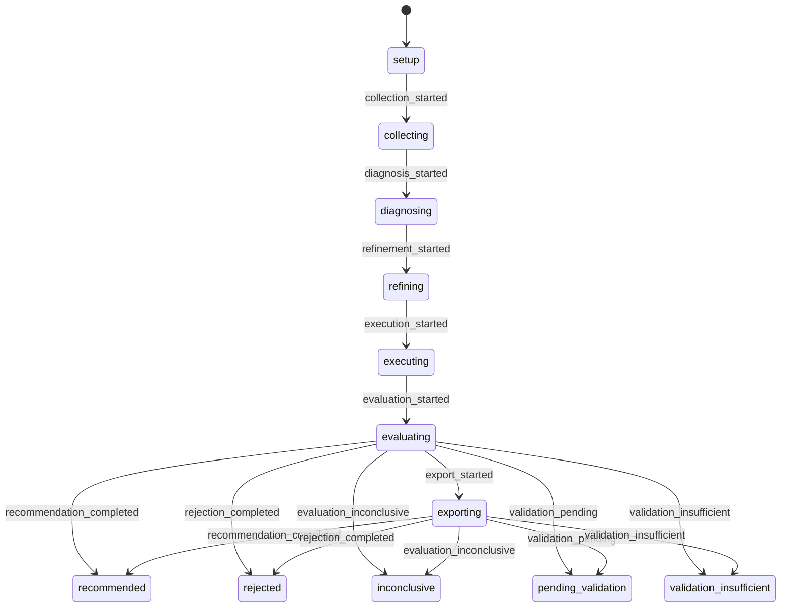
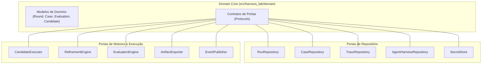

# Modelo de Domínio e Contratos de Portas

O módulo de domínio (`src/harness_lab/domain`) constitui o núcleo conceitual do **Harness Lab**. Ele define as entidades fundamentais, as máquinas de estado e as interfaces abstratas (portas) que regem o ciclo de otimização e avaliação contínua de agentes de Inteligência Artificial.

Seguindo os princípios da **Arquitetura Hexagonal (Ports and Adapters)**, o domínio do Harness Lab é puramente declarativo e autossuficiente: não possui dependências com frameworks web (como FastAPI), bibliotecas de persistência (como SQLite) ou clientes HTTP/SDKs de terceiros.

---

## Princípios de Design e Convenções de Domínio

### 1. Imutabilidade e Validação Estrita (`DomainModel`)

Todos os modelos de domínio do Harness Lab derivam da classe base `DomainModel` (`src/harness_lab/domain/models/__init__.py`), construída sobre o `pydantic.BaseModel`.

```python
class DomainModel(BaseModel):
    model_config = ConfigDict(
        frozen=True,
        populate_by_name=True,
        alias_generator=to_camel,
        extra="forbid",
    )
```

A configuração base impõe as seguintes regras invariantes:
- **Imutabilidade (`frozen=True`)**: Nenhuma instância de modelo de domínio pode ter seus atributos alterados após a criação. Modificações de estado criam novas instâncias via `model_copy(update=...)`.
- **Serialização em camelCase (`alias_generator=to_camel`)**: Os atributos em Python utilizam a convenção `snake_case`, mas são automaticamente mapeados e serializados para `camelCase` nas fronteiras de API e JSON.
- **Proibição de Atributos Extras (`extra="forbid"`)**: Payloads com campos não declarados são sumariamente rejeitados durante a validação.
- **Rejeição de `null` Explícito em Campos Opcionais Omíssiveis**: Atributos opcionais projetados para omissão (como `source_reference`, `synthetic_label` ou `opaque_payload`) possuem validadores de campo (`field_validator`) que lançam exceção se o valor `None` for passado explicitamente, exigindo que o campo seja totalmente omitido do payload.

### 2. Identificadores Fortemente Tipados (Branded IDs)

Para evitar erros de atribuição acidental entre diferentes categorias de identificadores (por exemplo, passar um `CaseId` onde se espera um `RoundId`), o domínio utiliza o padrão *Branded Types* através de `typing.NewType`:

- `RoundId`, `AgentId`, `DomainId`, `CaseId`, `EventId`, `CheckpointId`, `SecretId`, `ExportId`
- `EvaluationId`, `EvidenceId`, `FindingId`, `HypothesisId`
- `HarnessSnapshotId`, `CandidateId`, `ExecutionId`

---

## Entidades e Modelos do Domínio

O modelo de domínio é organizado em submodelos coesos situados em `src/harness_lab/domain/models/`.


*Relacionamentos estruturais entre as principais entidades do modelo de domínio do Harness Lab.*

### 1. Rodadas e Ciclo de Vida (`round.py`)

A entidade `Round` representa uma rodada de otimização de um agente em determinado domínio.

```python
class Round(DomainModel):
    id: RoundId
    agent_id: AgentId
    domain_id: DomainId
    state: RoundState
    objective: str
    created_at: str
    updated_at: str
```

#### Estados e Máquina de Transição

O ciclo de vida de um `Round` é dividido em **estados ativos** (`ActiveRoundState`) e **decisões terminais** (`TerminalDecision`).


*Diagrama de transição de estados do ciclo de vida de uma rodada (`Round`).*

- **Estados Ativos**: `setup`, `collecting`, `diagnosing`, `refining`, `executing`, `evaluating`, `exporting`.
- **Estados Terminais**: `recommended`, `rejected`, `inconclusive`, `pending_validation`, `validation_insufficient`, `stopped_by_limit`, `cancelled`, `integration_failed`.
- **Invariantes de Transição**:
  - As transições são controladas pelo dicionário `ROUND_TRANSITIONS` e executadas via `transition_round(state, event)`.
  - Transições a partir de qualquer estado terminal disparam `ValueError`.
  - Os eventos de erro/interrupção `cancel_requested`, `integration_failed` e `limit_reached` são permitidos a partir de qualquer estado ativo.

As alterações de estado são registradas de forma imutável por `apply_round_event`:

```python
def apply_round_event(round_obj: Round, event: RoundEvent, occurred_at: str) -> Round:
    return round_obj.model_copy(
        update={
            "state": transition_round(round_obj.state, event),
            "updated_at": occurred_at,
        }
    )
```

Junto à atualização de estado, são gerados registros de `RoundProgressEvent` e `RoundCheckpoint` para auditoria e recuperação de progresso.

---

### 2. Casos e Particionamento (`case.py`, `partition.py`)

Os testes e amostras de dados utilizados na avaliação do agente são estruturados como casos de teste.

- `PartitionCase`: Modelo base contendo `id`, `session_id`, `similarity_group` e `content`.
- `CaseRecord`: Estende `PartitionCase` adicionando escopo do agente (`agent_id`, `domain_id`), origem do caso (`source`: `manual`, `json`, `csv`, `historical`, `synthetic`) e metadados opcionais (`source_reference`, `synthetic_label`).
- `PartitionManifest`: Registro imutável do particionamento determinístico do conjunto de casos (`seed`, `diagnosis_ids`, `reserved_ids`, `created_at`).
- `PartitionOptions`: Parâmetros de configuração para divisão de casos entre diagnóstico e reserva (`minimum_reserved`, `reserved_ratio`).

---

### 3. Evidências e Diagnóstico (`evidence.py`)

Durante as fases de coleta e diagnóstico, falhas ou lacunas de dados são convertidas em evidências estruturadas.

#### Tipos de Evidência (União Discriminada por `kind`)
1. `EvidenceTrace` (`kind="trace"`): Fragmento ou trecho extraído do trace de execução do agente (`trace_id`, `observation_id`, `excerpt`, `source_url`).
2. `EvidenceExecution` (`kind="execution"`): Resultado resumido de uma execução (`execution_id`, `excerpt`).
3. `EvidenceMissingData` (`kind="missing_data"`): Campo ausente ou dado truncado identificador de anomalia (`field`, `source_reference`).

#### Achados e Hipóteses
- `Finding`: Agrupa uma ou mais evidências (`evidence_ids`) com base em padrão de falha observada (`category_code`, `observed_fact`, `frequency`, `sample_size`, `severity`: `low`, `medium`, `high`, `critical`, `impact`, `confidence`).
- `Hypothesis`: Formula uma explicação causal vinculada a um achado (`finding_id`), evidências e o efeito esperado (`expected_effect`).

---

### 4. Harness, Snapshots e Candidatos (`harness.py`)

A configuração do agente e as propostas de alteração são encapsuladas pelas entidades de Harness.

- `HarnessSnapshot`: Captura o estado completo do agente em determinado momento (`agent_id`, `domain_id`, `version`, `components`, `immutable_constraints`, `created_at`).
  - Permite metadados opcionais como `source_version`, `artifact_hash` e `opaque_payload` (dicionário arbitrário preservado sem perda de estrutura).
- `CandidateChange`: Representa uma modificação individual em um componente (`component`, `before`, `after`, `rollback`, `expected_effect`).
- `Candidate`: Proposta de otimização gerada pelo motor de refinamento contendo a foto de baseline (`baseline_id`), a nova foto (`snapshot`), a lista de alterações (`changes`), hipóteses associadas (`hypothesis_ids`) e evidências de suporte (`evidence_ids`).
- `ExecutionMetrics`: Atributos quantitativos da execução (`input_tokens`, `output_tokens`, `cost`, `latency_ms`).
- `ExecutionResult`: Resultado da execução de um caso contra o harness baseline ou candidato (`status`: `succeeded`, `agent_failed`, `integration_failed`, `trace_missing`, `timed_out`, `cancelled`).

---

### 5. Avaliação (`evaluation.py`, `evaluator.py`)

A tomada de decisão sobre recomendar ou rejeitar um candidato baseia-se na comparação quantitativa entre a execução do baseline e a do candidato.

- `CaseEvaluation`: Resultado do confronto caso a caso (`passed`, `regression`, `score_change`, `critical_violations`).
- `EvaluationResult`: Avaliação consolidada da rodada, contendo a decisão final (`decision`: `TerminalDecision`), nível de confiança (`confidence`), tamanho da amostra (`sample_size`), variações agregadas de pontuação, custo e latência, além da justificativa (`rationale`).
- `VersionedEvaluationResult`: Estende `EvaluationResult` registrando a versão do avaliador (`evaluator_version`).
- `EvaluatorDefinition`: Define os critérios de aceite (`minimum_sample_size`, `recommendation_threshold`, `maximum_regression_rate`).

---

## Contratos de Portas (`src/harness_lab/domain/ports.py`)

Os contratos de portas isolam totalmente a lógica de negócio das implementações técnicas concretas. São definidos como `typing.Protocol` assíncronos.


*Mapeamento dos contratos de portas declarados em `domain/ports.py`.*

### 1. Portas de Repositório e Persistência

- `RunRepository`: Gestão do estado e persistência atômica de progresso da rodada.
  - `get_round(id: RoundId) -> Round | None`
  - `save_round(round_obj: Round) -> None`
  - `commit_progress(*, round_obj, checkpoint, event) -> None`
  - `list_events(round_id, after_sequence) -> tuple[RoundProgressEvent, ...]`
- `CaseRepository`:
  - `save_many(cases: tuple[CaseRecord, ...]) -> int`
  - `list_by_scope(agent_id, domain_id) -> tuple[CaseRecord, ...]`
- `TraceRepository`:
  - `collect(query: TraceQuery) -> TracePage`
- `AgentHarnessRepository`:
  - `get_capabilities(agent_id: AgentId) -> AgentCapabilities`
  - `get_snapshot(id: HarnessSnapshotId) -> HarnessSnapshot | None`
  - `save_snapshot(snapshot: HarnessSnapshot) -> None`
- `SecretStore`:
  - `save(id, secret)`, `get(id)`, `rotate(id, secret)`, `delete(id)`

### 2. Portas de Motores e Execução

- `CandidateExecutor`: Executa casos de teste contra versões baseline ou candidatas.
  - `execute(request: CandidateExecutionRequest) -> ExecutionResult`
- `RefinementEngine`: Gera propostas de candidatos com base nos achados e hipóteses.
  - `refine(request: RefinementRequest) -> tuple[Candidate, ...]`
- `EvaluationEngine`: Executa a comparação estatística entre baseline e candidato.
  - `evaluate(request: EvaluationRequest) -> EvaluationResult`
- `ArtifactExporter`: Exporta relatórios e artefatos de candidatos.
  - `export(request: ArtifactExportRequest) -> tuple[ExportedArtifact, ...]`
- `EventPublisher`: Publica eventos de progresso para subsistemas externos e SSE.
  - `publish(event: RoundProgressEvent) -> None`

---

## Requisições Discriminadas e Segurança nas Portas

### 1. União Discriminada em Requisições de Execução

As requisições enviadas ao `CandidateExecutor` utilizam união discriminada pelo campo `kind`:

```python
class BaselineExecutionRequest(_ExecutionRequestContext):
    kind: Literal["baseline"]

class CandidateVersionExecutionRequest(_ExecutionRequestContext):
    kind: Literal["candidate"]
    candidate_id: CandidateId

CandidateExecutionRequest: TypeAlias = Annotated[
    BaselineExecutionRequest | CandidateVersionExecutionRequest,
    Field(discriminator="kind"),
]
```

A função auxiliar `parse_candidate_execution_request(payload)` utiliza um `TypeAdapter` para validar rigorosamente a variante recebida.

### 2. Exportação de Artefatos Discriminada

De forma análoga, `ArtifactExportRequest` diferencia requisições de exportação de candidato (`CandidateArtifactExportRequest`) de relatórios finais (`ReportArtifactExportRequest`), parsed via `parse_artifact_export_request`.

### 3. Proteção de Segredos (`SecretValue`)

O modelo `SecretValue` estipula segurança em nível de representação textual para evitar o vazamento inadvertido de credenciais em logs ou dumps de depuração:

```python
class SecretValue(DomainModel):
    value: str = Field(repr=False)
```

Sua inclusão em reprs é omitida por padrão (`repr=False`), conforme verificado nos testes unitários.

---

## Verificação e Testes de Invariância

A integridade do modelo de domínio e seus contratos é garantida por uma suíte dedicada de testes em `tests/unit/domain/`:

1. **Garantia de Isolamento Arquitetural (`test_ports.py`)**:
   O teste `test_domain_has_no_fastapi_sqlite_or_adapter_imports` inspeciona o código-fonte do módulo `harness_lab.domain` e assegura que tokens proibidos (`fastapi`, `sqlite`, `adapters`, `httpx`) jamais sejam importados no domínio.
2. **Fidelidade de Serialização CamelCase (`test_models.py`)**:
   A suíte valida a conversão completa idempotente (roundtrip) contra o fixture oficial `tests/contracts/fixtures/domain/models-roundtrip.json`.
3. **Máquina de Estado e Imutabilidade (`test_round.py`)**:
   Valida que `apply_round_event` devolve uma nova instância sem alterar a original, rejeita transições inválidas (ex.: acionar `evaluation_started` direto de `setup`) e impede alterações após atingir estado terminal.
