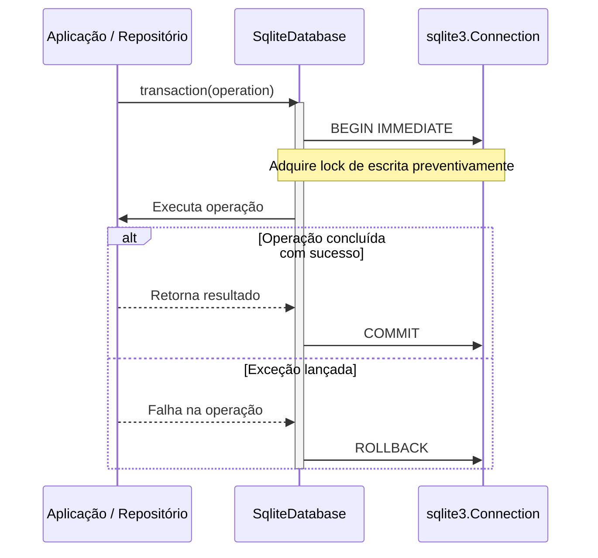
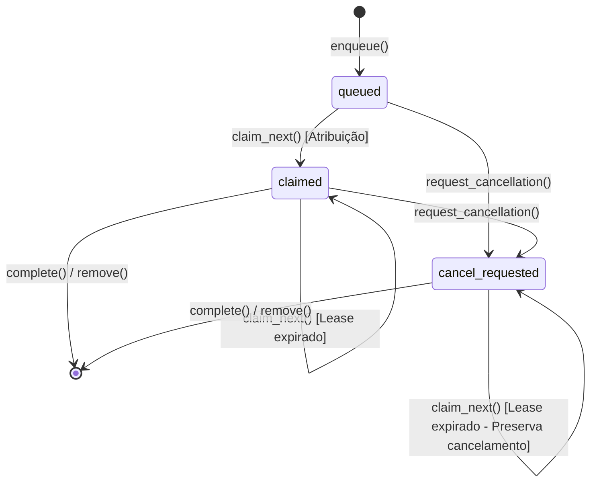

# Persistência e Armazenamento em SQLite

A camada de persistência do **Harness Lab** (`src/harness_lab/adapters/sqlite`) é responsável por armazenar todo o estado operacional do sistema, incluindo especificações de agentes, histórico de execuções (*rounds*), snapshots de harness, eventos de progresso, artefatos de sessão e filas de tarefas em segundo plano.

Projetada com base na **Arquitetura Hexagonal (Ports and Adapters)**, a persistência isola totalmente as regras de negócio declaradas no [Modelo de Domínio](domain-model.md) das particularidades do mecanismo de banco de dados relacional. Toda a interação é mediada por adaptadores que utilizam a biblioteca padrão `sqlite3` do Python, com configurações otimizadas para concorrência de alta vazão e integridade transacional rigorosa.

---

## Configuração do Cliente e Concorrência WAL

A criação e inicialização da conexão com o SQLite ocorrem por meio da função `open_sqlite_database` (`src/harness_lab/adapters/sqlite/client.py`). A conexão é aberta com `isolation_level=None` (modo *autocommit* nativo do driver Python) e `check_same_thread=False`, transferindo o controle do ciclo de vida transacional explicitamente para o wrapper `SqliteDatabase`.

### Pragmas e Otimizações de Concorrência

Sempre que uma conexão é estabelecida, um conjunto de pragmas do SQLite é aplicado:

1. **Integridade Referencial (`PRAGMA foreign_keys = ON`)**: Habilita a verificação ativa de chaves estrangeiras em todas as operações de escrita, garantindo integridade relacional no nível da *engine*.
2. **Tratamento de Contenção (`PRAGMA busy_timeout = 5000`)**: Define um tempo limite de tolerância de até 5000 milissegundos (5 segundos) caso o banco esteja bloqueado por outra transação de escrita, evitando exceções imprevistas de `sqlite3.OperationalError: database is locked`.
3. **Write-Ahead Logging (`PRAGMA journal_mode = WAL`)**: Para bancos de dados persistidos em arquivo no disco (`path != ":memory:"`), o modo WAL é ativado. Esse modo permite que múltiplos leitores executem consultas simultaneamente sem bloquear transações de escrita e sem serem bloqueados por elas.
4. **Sincronização de Disco (`PRAGMA synchronous = FULL`)**: Garante durabilidade estrita após *commits*, sincronizando o log de transações (*WAL journal*) com o armazenamento físico antes que a transação seja dada como concluída.

> **Nota**: Bancos em memória (`:memory:`) omitem a ativação dos pragmas `journal_mode = WAL` e `synchronous = FULL`, otimizando a execução em ambientes de testes integrados temporários.

---

## Gerenciamento de Transações e Concorrência (`SqliteDatabase`)

A classe `SqliteDatabase` envolve a conexão `sqlite3.Connection` e gerencia a execução de instruções SQL e o controle de transações concorrentes.

### Transações Atômicas com `BEGIN IMMEDIATE`

Para evitar impasses (*deadlocks*) decorrentes do *lock escalation* (quando uma transação iniciada como leitura tenta posteriormente realizar uma escrita), o método `transaction(operation)` adquire o bloqueio de escrita antecipadamente utilizando o comando `BEGIN IMMEDIATE`.


Ciclo de vida de gerenciamento de transações com `BEGIN IMMEDIATE` e rollback automático no `SqliteDatabase`.

### Reentrância e Sincronização Thread-Safe

O gerenciamento de transações possui duas propriedades fundamentais de segurança:

- **Sincronização Reentrante (`threading.RLock`)**: Um bloqueio reentrante garante que threads distintas não entrem em condição de corrida ao utilizar a mesma instância de banco de dados.
- **Suporte a Transações Aninhadas (`_transaction_depth`)**: O contador interno `_transaction_depth` monitora o nível de aninhamento. Se uma função já estiver dentro de um bloco transacional ativo (`_transaction_depth > 0`), as operações subsequentes ocorrem no contexto da mesma transação sem emitir comandos duplicados de `BEGIN` ou `COMMIT`.
- **Tratamento e Reversão em Caso de Falha**: Se uma exceção for disparada durante a execução da operação, o sistema executa um `ROLLBACK`. Caso o próprio *rollback* falhe por um erro de conexão, ambas as exceções são encadeadas e relançadas em uma exceção `RuntimeError("Transaction and rollback failed")`.

---

## Sistema de Migrações Versionadas

O esquema do banco de dados é gerenciado declarativamente através de scripts SQL contidos no diretório `src/harness_lab/adapters/sqlite/migrations/`. A aplicação automática ocorre na inicialização através da função `_migrate`.

### Tabela de Controle `schema_migrations`

O histórico de atualizações é registrado na tabela `schema_migrations`:

```sql
CREATE TABLE IF NOT EXISTS schema_migrations (
  name TEXT PRIMARY KEY,
  checksum TEXT,
  applied_at TEXT NOT NULL
);
```

### Sequência de Migrações

A ordem de aplicação das migrações é rigidamente determinada por uma tupla versionada:

| Versão | Script SQL | Descrição da Migração |
| :--- | :--- | :--- |
| `0001` | `0001_foundation.sql` | Criação do esquema base (`agents`, `connections`, `capabilities`, `harness_versions`, `rounds`, `round_events`, `checkpoints`, `cases`, `case_partitions`, `executions`, `findings`, `proposals`, `evaluations`, `learnings`, `exports`). |
| `0002` | `0002_immutable_harness.sql` | Adição de *triggers* de imutabilidade para proibir `UPDATE` e `DELETE` na tabela `harness_versions`. |
| `0003` | `0003_scope_integrity.sql` | Criação de índice único em `agents(id, domain_id)` e *triggers* de validação de escopo relacional cruzado entre tabelas filhas e pai. |
| `0004` | `0004_encrypted_secrets.sql` | Suporte a segredos criptografados de conexões. |
| `0005` | `0005_connection_registrations.sql` | Registro e controle de integrações externas. |
| `0006` | `0006_round_jobs.sql` | Criação da tabela de fila de tarefas de rodadas (`round_jobs`). |
| `0007` | `0007_round_artifacts.sql` | Criação do repositório de snapshots e artefatos de rodada (`round_artifacts`). |
| `0008` | `0008_round_job_cancellation_leases.sql` | Reestruturação da tabela `round_jobs` com suporte a *leases* temporizados e retenção do estado `cancel_requested`. |

### Verificação de Integridade e Compatibilidade de Legado

Para garantir que migrações passadas não foram alteradas indevidamente:

1. **Checksum SHA-256 (`_migration_checksum`)**: A soma de verificação em SHA-256 do arquivo SQL no disco é calculada e comparada com o valor gravado na coluna `checksum`. Se houver divergência, a abertura do banco é interrompida com `ValueError("Migration checksum mismatch: <name>")`.
2. **Validação Retroativa de Schemas Legados (`_verify_legacy_migration`)**: Registros antigos sem checksum (`checksum IS NULL`) são validados dinamicamente. Para a migração `0001_foundation`, o código executa o SQL em um banco temporário em memória e valida a igualdade estrutural normalizada das tabelas. Para a `0002_immutable_harness`, valida a presença dos *triggers* de imutabilidade.
3. **Verificação de Escopo Retroativo (`_verify_existing_scope`)**: Antes de aplicar a migração `0003_scope_integrity`, uma consulta relacional via `UNION ALL` varre o banco existente. Se existirem linhas desalinhadas em relação ao escopo (`agent_id`, `domain_id`), a migração é rejeitada para impedir corrupção de dados.

---

## Integridade do Modelo de Dados, Triggers e Imutabilidade

O esquema do SQLite utiliza restrições de integridade e *triggers* para garantir regras de negócio no próprio nível do armazenamento.

### Imutabilidade do Harness Snapshot (`0002_immutable_harness.sql`)

Uma versão publicada de harness jamais pode ser modificada ou removida. Essa regra é imposta por dois *triggers* SQL:

```sql
CREATE TRIGGER harness_versions_reject_update
BEFORE UPDATE ON harness_versions
BEGIN
  SELECT RAISE(ABORT, 'harness_versions rows are immutable: UPDATE is not allowed');
END;

CREATE TRIGGER harness_versions_reject_delete
BEFORE DELETE ON harness_versions
BEGIN
  SELECT RAISE(ABORT, 'harness_versions rows are immutable: DELETE is not allowed');
END;
```

### Validação Mútua de Escopo (`0003_scope_integrity.sql`)

Todas as entidades subordinadas a um agente (como rodadas, casos, execuções, conexões, achados e propostas) precisam pertencer exatamente ao mesmo escopo de domínio (`domain_id`).

Os *triggers* em `INSERT` validam a existência da entidade pai com o mesmo par `(id, domain_id)`. Além disso, o *trigger* `rounds_reject_scope_update` previne qualquer alteração posterior dos campos de identidade e criação de uma rodada existente (`agent_id`, `domain_id`, `created_at`).

---

## Armazenamento de Artefatos de Rodada (`SqliteRoundArtifactStore`)

O adaptador `SqliteRoundArtifactStore` (`src/harness_lab/adapters/sqlite/round_artifact_store.py`) é responsável por salvar e recuperar o snapshot completo da sessão de uma rodada (*round session artifact*).

### Estrutura da Tabela `round_artifacts`

```sql
CREATE TABLE round_artifacts (
  round_id TEXT PRIMARY KEY REFERENCES rounds(id) ON DELETE CASCADE,
  payload_version INTEGER NOT NULL DEFAULT 1,
  payload_json TEXT NOT NULL,
  updated_at TEXT NOT NULL
);
```

### Validação do Payload com Pydantic (`_Session`)

Antes da gravação, o dicionário da sessão é validado pelo modelo de Pydantic `_Session` com `extra="forbid"`, assegurando conformidade estrita do contrato de dados:

- `cases`: Lista de instâncias `_Case` (contendo `id`, `sessionId`, `similarityGroup`, `content`).
- `partition`: Estrutura `_Partition` (versão, semente, IDs de diagnósticos e IDs reservados).
- `baseline`: Especificação `_Baseline` (IDs do agente, componentes, restrições imutáveis e hashes).
- `capabilities`: Configuração `_Capabilities` de edição e suporte a replicação de ferramentas.
- `diagnosis` e `refinement`: Coleta de evidências, hipóteses, candidatos e lições aprendidas.
- `reservedExecutions` e `evaluation`: Histórico de execuções reservadas e estado final de avaliação.

### Operações de Leitura e Escrita

- **`save(round_id, session)`**: Converte a sessão validada para JSON compacto (`separators=(",", ":")`) e executa um *upsert* atômico dentro de uma transação:
  ```sql
  INSERT INTO round_artifacts (round_id, payload_version, payload_json, updated_at)
  VALUES (?, 1, ?, ?)
  ON CONFLICT(round_id) DO UPDATE SET
    payload_version = excluded.payload_version,
    payload_json = excluded.payload_json,
    updated_at = excluded.updated_at
  ```
- **`get(round_id)`**: Recupera o registro, verifica se `payload_version == 1` (lançando `ValueError("ROUND_ARTIFACT_VERSION_UNSUPPORTED")` caso contrário), e deserializa o payload validando a estrutura de volta em um dicionário serializável com aliases em `camelCase`.

---

## Fila de Trabalhos e Leases de Cancelamento (`SqliteRoundJobStore`)

O gerenciamento de execução assíncrona de rodadas pelos *workers* em segundo plano utiliza a tabela `round_jobs` (`src/harness_lab/adapters/sqlite/round_job_store.py`).

### Schema e Invariantes de Estado (`0008_round_job_cancellation_leases.sql`)

```sql
CREATE TABLE round_jobs (
  round_id TEXT PRIMARY KEY REFERENCES rounds(id) ON DELETE CASCADE,
  status TEXT NOT NULL CHECK (status IN ('queued', 'claimed', 'cancel_requested')),
  claimed_by TEXT,
  claimed_at TEXT,
  created_at TEXT NOT NULL,
  updated_at TEXT NOT NULL,
  CHECK (
    (status = 'queued' AND claimed_by IS NULL AND claimed_at IS NULL) OR
    (status = 'claimed' AND claimed_by IS NOT NULL AND claimed_at IS NOT NULL) OR
    (status = 'cancel_requested' AND (
      (claimed_by IS NULL AND claimed_at IS NULL) OR
      (claimed_by IS NOT NULL AND claimed_at IS NOT NULL)
    ))
  )
);
```

### Máquina de Estados e Ciclo de Vida do Job


Máquina de estados das tarefas na tabela `round_jobs`, destacando a renovação de lease e retenção do pedido de cancelamento.

### Mecanismo de Claim e Expiração de Lease

Para prevenir que trabalhadores travados prendam execuções indefinidamente:

1. **Atribuição Atômica (`claim_next`)**: O *worker* solicita a próxima tarefa informando seu `worker_id` e horário atual. A consulta calcula a data de expiração do *lease* (`now - lease_ms`, onde `lease_ms` tem o padrão de 30.000 ms / 30 segundos).
2. **Critério de Seleção**: A consulta seleciona a tarefa criada há mais tempo que esteja:
   - No estado `'queued'`; ou
   - No estado `'cancel_requested'` sem trabalhador atrelado (`claimed_by IS NULL`); ou
   - Nos estados `'claimed'` ou `'cancel_requested'` cujo `claimed_at` seja anterior ao tempo limite do *lease* (`claimed_at < lease_cutoff`).
3. **Preservação de Cancelamento**: Durante a atualização atômica (`UPDATE ... RETURNING round_id`), a instrução SQL aplica `SET status = CASE WHEN status = 'cancel_requested' THEN status ELSE 'claimed' END`. Isso garante que, se uma solicitação de cancelamento foi gravada enquanto o *lease* anterior expirava, o novo *worker* assumirá a tarefa já ciente de que o cancelamento foi solicitado.

---

## Repositórios de Domínio Concretos

Os adaptadores de repositório conectam as entidades do [Modelo de Domínio](domain-model.md) às operações de tabela no SQLite.

### Repositório de Execução (`SqliteRunRepository`)

O `SqliteRunRepository` (`src/harness_lab/adapters/sqlite/run_repository.py`) abstrai as operações sobre `rounds`, `round_events`, `checkpoints` e `harness_versions`:

- **Registro Atômico de Progresso (`commit_progress`)**: Grava a atualização do estado da rodada na tabela `rounds`, insere o snapshot de progresso na tabela `checkpoints` e armazena o evento na tabela `round_events` dentro de um único bloco `database.transaction(...)`.
- **Criação Combinada de Rodada e Job (`create_round_with_job`)**: Cria o registro inicial da rodada e insere o job na fila `round_jobs` atomicamente, impedindo inconsistências onde uma rodada seja criada sem o respectivo agendamento.

### Repositório de Casos (`SqliteCaseRepository`)

O `SqliteCaseRepository` (`src/harness_lab/adapters/sqlite/case_repository.py`) gerencia o lote de casos de teste:

- **Importação em Lote Segura (`save_many`, `save_many_ignoring_existing`)**: Permite a inserção de até `MAX_CASES_PER_IMPORT = 500` registros em uma única transação. Caso ocorra uma violação de chave primária ou falha de escopo em qualquer item do lote, toda a transação é desfeita (*rollback*), impedindo persistência parcial de conjuntos de casos.

---

## Garantias de Testes e Validação de Integração

A camada de persistência é coberta por suítes de testes de integração em `tests/integration/sqlite/`:

- **`test_artifacts.py`**: Valida a gravação, *upsert* e recuperação de artefatos de rodada, confirmando a rejeição de cargas com `payload_version` incompatível ou JSON malformatado.
- **`test_jobs.py`**: Verifica a ordem de concorrência e atribuição de tarefas por data de criação, recuperação de *leases* expirados, solicitação de cancelamento e integridade do direito de conclusão por *worker_id*.
- **`test_migrations.py`**: Garante a correta execução de todas as 8 migrações em bancos de dados baseados em arquivo e em memória, valida a recusa de bancos com checksum adulterado e testa o descarte de esquemas com violação de integridade relacional retroativa.
- **`test_repositories.py`**: Garante atomicidade em operações de *commit* de progresso de rodada e reversão transacional em lote do repositório de casos.

---

## Páginas Relacionadas

- [Visão Geral do Sistema](system-overview.md)
- [Modelo de Domínio](domain-model.md)
- [Backup e Recuperação](../operations/backup-recovery.md)
