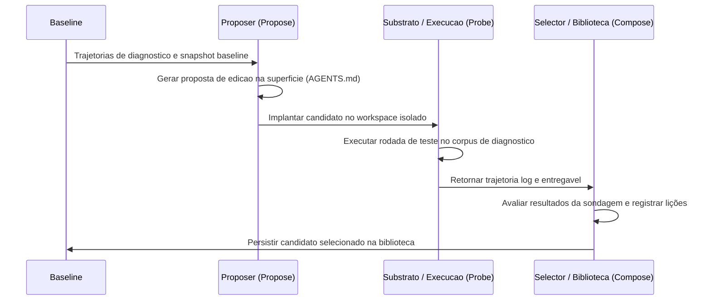

# Framework Harness2 e Metodologia de Avaliação

O **Harness Lab** adota os fundamentos metodológicos do projeto upstream **Google Research Harness2** (fixado no commit `1cfe254e8d25b15f37048c3730134686abe60335`, sob licença Apache-2.0, ver [`docs/referencias.md`](../../docs/referencias.md)). O objetivo central desta abordagem é substituir o processo empírico de refinamento de agentes de IA — historicamente baseado em tentativa e erro ad-hoc em engenharia de prompts — por um ciclo iterativo, determinístico, auditável e fundamentado em evidências.

Nesta arquitetura, a otimização de um agente de IA não é feita diretamente sobre os casos de teste finais, nem por modificações cegas. Em vez disso, o Harness Lab opera por meio da criação de **baselines**, execução do ciclo **Propose-Probe-Compose**, **probing estruturado de candidatos** e uma **barreira inviolável de isolamento entre diagnóstico e validação reservada**.

---

## 1. Arquitetura Upstream e Substrato Adaptativo

A integração com a especificação do Harness2 upstream no Harness Lab é viabilizada através de adaptadores especializados localizados em `src/harness_lab/adapters/harness2/`. O framework define abstratamente os componentes do ambiente de benchmark e a superfície modificável do agente:

* **Especificação de Benchmark (`BenchSpec`, `BenchPrompts`, `ChannelSpec`)**: Define a configuração do benchmark, caminhos de execução, modos de instalação e os canais de comunicação com modelos (e.g., papéis de `proposer` e `selector`), como demonstrado em `InMemoryBenchmarkAdapter` ([`src/harness_lab/adapters/harness2/benchmark.py`](../../src/harness_lab/adapters/harness2/benchmark.py#L24-L36)).
* **Superfície Editável e Substrato (`SurfaceSpec`, `EditableSurfaceSubstrate`)**: Abstrai a estrutura de arquivos que compõem o agente ou seu harness (como o arquivo `AGENTS.md`). O adaptador `EditableSurfaceSubstrate` garante que a árvore de arquivos de base cumpra a especificação `CODEX_SURFACE` ([`src/harness_lab/adapters/harness2/substrate.py`](../../src/harness_lab/adapters/harness2/substrate.py#L12-L29)).
* **Repositório de Biblioteca (`library_store.Library`)**: Armazena de forma persistente a árvore do harness refinado, lições aprendidas (`EXPERIENCE.md`) contendo pistas, evidências e níveis de confiança gerados ao longo dos ciclos ([`tests/unit/adapters/harness2/test_upstream_contract.py`](../../tests/unit/adapters/harness2/test_upstream_contract.py#L124-L125), [`#L178-L186`](../../tests/unit/adapters/harness2/test_upstream_contract.py#L178-L186)).

---

## 2. O Ciclo Iterativo Propose-Probe-Compose

A metodologia do Harness2 baseia-se em uma abordagem tripartida para a melhoria contínua de agentes: **Propose**, **Probe** e **Compose**. Este fluxo é orquestrado por agendadores upstream como `run_task` ([`tests/unit/adapters/harness2/test_upstream_contract.py`](../../tests/unit/adapters/harness2/test_upstream_contract.py#L126-L135)).


*Fluxo do ciclo iterativo Propose-Probe-Compose no framework Harness2.*

### 2.1. Fase de Proposição (`Propose`)
Na fase **Propose**, o sistema analisa o snapshot de referência (`baseline`) e as falhas identificadas na fase de diagnóstico para gerar candidatos a modificação (`Candidate`). Cada proposta especifica o componente afetado, o conteúdo anterior, o novo conteúdo, a instrução de reversão (`rollback`) e o efeito esperado ([`src/harness_lab/domain/models/harness.py`](../../src/harness_lab/domain/models/harness.py#L40-L56)).

Antes da aceitação de qualquer proposta, o módulo de política de alteração (`validate_proposal`) aplica duas validações estritas:
1. **Componentes Suportados**: O componente alterado deve fazer parte da lista de componentes suportados e estar presente no baseline ([`src/harness_lab/application/refinement/change_policy.py`](../../src/harness_lab/application/refinement/change_policy.py#L24-L28)).
2. **Restrições Imutáveis**: A proposta é rejeitada com o código `IMMUTABLE_CONSTRAINT` caso contenha qualquer fragmento definido nas restrições imutáveis do baseline ([`src/harness_lab/application/refinement/change_policy.py`](../../src/harness_lab/application/refinement/change_policy.py#L29-L33)).

### 2.2. Fase de Sondagem (`Probe`)
Na fase **Probe**, o candidato aceito é implantado temporariamente em um ambiente de execução isolado (workspace no substrato). O adaptador executa os casos de diagnóstico selecionados ([`src/harness_lab/adapters/harness2/benchmark.py`](../../src/harness_lab/adapters/harness2/benchmark.py#L56-L70)):
* Captura o arquivo de entregável (`deliverable.txt`) e valida sua criação via `delivered()`.
* Trunca e registra o log de trajetória (`trajectory.log`) contendo as ações e observações do agente.
* Registra métricas de desempenho (`ExecutionMetrics`), incluindo tokens de entrada e saída, custo estimado e latência em milissegundos ([`src/harness_lab/domain/models/harness.py`](../../src/harness_lab/domain/models/harness.py#L68-L74)).

### 2.3. Fase de Composição (`Compose`)
Na fase **Compose**, o seletor upstream compara os resultados das sondagens efetuadas pelos diferentes candidatos. Caso o candidato apresente ganhos sem introduzir regressões:
* As edições no harness são consolidadas na árvore de arquivos final (`AGENTS.md`).
* Uma nova entrada de experiência (`EXPERIENCE.md`) é gravada no repositório `Library`, contendo o gatilho (`cue`), a lição aprendida (`lesson`) e a evidência empírica (`evidence`) ([`tests/unit/adapters/harness2/test_upstream_contract.py`](../../tests/unit/adapters/harness2/test_upstream_contract.py#L60-L67), [`#L178-L186`](../../tests/unit/adapters/harness2/test_upstream_contract.py#L178-L186)).

---

## 3. Isolamento Estrito entre Diagnóstico e Validação Reservada

Para evitar o fenômeno de **sobreajuste (overfitting)** — onde um agente se torna altamente otimizado para os casos em que foi treinado/refinado, mas perde capacidade de generalização —, o Harness Lab implementa regras matemáticas de isolamento entre o corpus de diagnóstico e o corpus reservado de validação.

<!-- openwiki: mermaid parse failed and this diagram was converted to a text fence so it does not break rendering. Fix the diagram source and restore the mermaid fence. Parser error: Heuristic: an unescaped angle bracket inside a label breaks rendering; rephrase the label. -->
```text
flowchart TD
    Corpus["Corpus de Casos (PartitionCase)"] --> Partitioning["partition_cases(seed)"]
    Partitioning --> Grouping["Agrupamento Transitivo<br/>(session_id / similarity_group)"]
    Grouping --> Ranking["Ordenacao Deterministica SHA-256"]
    Ranking --> Manifest["Manifesto Selado<br/>(PartitionManifest)"]

    Manifest -->|diagnosis_ids| DiagnosisCorpus["Corpus de Diagnostico<br/>(run_refinement_with_diagnosis_cases)"]
    Manifest -->|reserved_ids| ReservedCorpus["Corpus Reservado<br/>(evaluate_candidate)"]

    subgraph IsolationBoundary["Barreira de Isolamento Estrito"]
        DiagnosisCorpus --> Cycle["Ciclo Propose-Probe-Compose"]
        Cycle --> CandidateGen["Candidato Gerado"]
    end

    CandidateGen --> EvalGate["Avaliacao Reservada<br/>(assert_learning_sources)"]
    ReservedCorpus --> EvalGate

    EvalGate --> Decision["Decisao Terminal<br/>(recommended / rejected / inconclusive)"]
```
*Arquitetura de particionamento determinístico e barreira de isolamento entre diagnóstico e validação reservada.*

### 3.1. Particionamento Transitivo Determinístico (`partition_cases`)
A função `partition_cases` divide os casos de teste em dois conjuntos disjuntos (`diagnosis_ids` e `reserved_ids`) com base em opções configuráveis (`seed`, `reserved_ratio`, `minimum_reserved`) ([`src/harness_lab/application/cases/partition_cases.py`](../../src/harness_lab/application/cases/partition_cases.py#L45-L83)):

1. **Agrupamento Transitivo**: Casos que compartilham o mesmo `session_id` ou o mesmo `similarity_group` são agrupados de forma transitiva em `_grouped_cases()`. Isso impede que dois testes semanticamente relacionados ou pertencentes à mesma sessão de usuário fiquem em lados opostos da barreira ([`src/harness_lab/application/cases/partition_cases.py`](../../src/harness_lab/application/cases/partition_cases.py#L19-L43)).
2. **Ordenação Estável por Hash SHA-256**: Os grupos resultantes são ordenados deterministicamente combinando a `seed` do manifesto e os IDs dos casos via hash SHA-256 (`_stable_rank`). Isso garante reproducibilidade idêntica entre diferentes execuções ([`src/harness_lab/application/cases/partition_cases.py`](../../src/harness_lab/application/cases/partition_cases.py#L14-L16)).
3. **Distribuição para Reserva**: Grupos inteiros são alocados para o conjunto de reserva até atingir o tamanho de meta (`target = max(minimum_reserved, ceil(n * reserved_ratio))`).

### 3.2. Selamento do Manifesto e Projeção de Diagnóstico
Antes de iniciar a etapa de refinamento, a função `seal_partition_manifest` congela o manifesto (`PartitionManifest`) contendo a divisão de IDs ([`src/harness_lab/application/cases/partition_cases.py`](../../src/harness_lab/application/cases/partition_cases.py#L86-L93)).

A execução do refinamento utiliza a função projetora `run_refinement_with_diagnosis_cases`. Esta função filtra rigorosamente os casos de teste fornecidos, tornando visíveis para o motor de proposição e sondagem **exclusivamente** os casos cujos IDs constam em `manifest.diagnosis_ids` ([`src/harness_lab/application/cases/partition_cases.py`](../../src/harness_lab/application/cases/partition_cases.py#L96-L107)). O refinador opera em total cegueira em relação aos casos reservados.

### 3.3. Bloqueio de Aprendizados e Validação Reservada
O sistema impõe duas verificações em nível de execução para assegurar a integridade do isolamento:

* **Validação de Fontes de Aprendizado (`assert_learning_sources`)**: Durante o refinamento, se uma proposta ou hipótese citar qualquer ID pertencente ao grupo reservado, a função interrompe a operação lançando o erro `RESERVED_CASE_EVIDENCE_FORBIDDEN` ([`src/harness_lab/application/cases/partition_cases.py`](../../src/harness_lab/application/cases/partition_cases.py#L110-L116)).
* **Validação de Avaliação (`evaluate_candidate`)**: Ao avaliar o candidato final, a função verifica se todos os sinais de teste submetidos pertencem estritamente ao grupo reservado (`reserved_case_ids`). Se algum caso não reservado for fornecido para a avaliação, o sistema rejeita a operação com `EVALUATION_CASE_NOT_RESERVED` ([`src/harness_lab/application/evaluation/evaluate_candidate.py`](../../src/harness_lab/application/evaluation/evaluate_candidate.py#L58-L60)).

---

## 4. Avaliação Multi-Gate e Recomendação Final

Após o término da fase Propose-Probe-Compose no corpus de diagnóstico, o candidato gerado passa por uma avaliação quantitativa e qualitativa no corpus reservado (`evaluate_candidate` e `decide_recommendation`). A decisão final (`TerminalDecision`) é regida por uma política de portas de segurança (gates) em cascata ([`src/harness_lab/application/evaluation/recommendation_policy.py`](../../src/harness_lab/application/evaluation/recommendation_policy.py#L28-L72)):

| Ordem de Avaliação | Portão de Segurança / Condição | Decisão Emitida | Racional Técnico / Causa |
| :--- | :--- | :--- | :--- |
| **1. Estado de Ciclo** | `lifecycle` diferente de `None` | `cancelled` / `integration_failed` / `stopped_by_limit` | A rodada foi interrompida ou sofreu falha de infraestrutura antes da conclusão. |
| **2. Tamanho de Amostra** | `sample_size < minimum_sample_size` | `validation_insufficient` | O número de casos reservados avaliados é inferior ao mínimo estatístico exigido. |
| **3. Falhas Críticas** | `critical_failure == True` | `rejected` | O candidato causou violação de regra crítica de negócio ou de segurança (`RULE_VIOLATION`). |
| **4. Portão Determinístico / Humano** | `deterministic_failure` ou `human_rejected` | `rejected` | O candidato falhou em asserções determinísticas ou foi rejeitado na revisão humana. |
| **5. Variabilidade** | `high_variability == True` | `inconclusive` | A oscilação nos deltas de conclusão entre execuções excede a variação máxima aceitável. |
| **6. Taxa de Regressão** | `regression_rate > maximum_regression_rate` | `rejected` | O percentual de casos com piora de desempenho excede o limite tolerado pela política. |
| **7. Limiar de Desempenho** | `aggregate_score >= recommendation_threshold` | `recommended` | O ganho médio de desempenho superou o limiar mínimo exigido de recomendação. |
| **8. Limiar Não Atingido** | `aggregate_score < recommendation_threshold` | `inconclusive` | Houve melhoria, mas insuficiente para atingir o limiar exigido de recomendação. |

---

## 5. Páginas Relacionadas

* [Valor de Negócio do Harness Lab](business-value.md): Explicação do impacto estratégico e ROI da avaliação determinística de agentes.
* [Fluxo de Particionamento e Diagnóstico](../workflows/case-partitioning-diagnosis.md): Guia prático do fluxo de criação de partições e diagnose de execuções.
* [Fluxo de Avaliação e Refinamento](../workflows/evaluation-refinement.md): Procedimentos operacionais para execução de rodadas e consolidação de candidatos.
