# Ciclo de Vida da Rodada (Round)

O ciclo de vida de uma **Round** (rodada) define o fluxo de estados e transições através do qual o objeto de domínio `Round` avança durante o processo de diagnóstico, refinamento, execução e avaliação de um agente. Governa a integridade do pipeline de experimentos no Harness Lab, garantindo imutabilidade, rastreabilidade e tratamento determinístico de falhas.

A máquina de estados finita (FSM) da `Round` é definida em `src/harness_lab/domain/models/round.py` e orquestrada pela classe de aplicação `ProcessRound` em `src/harness_lab/application/rounds/process_round.py`. Para mais detalhes sobre a arquitetura geral do sistema e a execução distribuída por workers, consulte [Modelo de Domínio](../architecture/domain-model.md), [Pipeline da Rodada](../workflows/round-pipeline.md) e [Runtime do Worker](../operations/worker-runtime.md).

---

## Visão Geral e Estrutura de Estados

O estado de uma rodada é representado pelo tipo `RoundState`, composto por dois grupos distintos: **Estados Ativos** (`ActiveRoundState`) e **Decisões Terminais** (`TerminalDecision`).

```python
RoundState = ActiveRoundState | TerminalDecision
```

### Estados Ativos (`ACTIVE_ROUND_STATES`)

Os estados ativos representam as fases operacionais sequenciais em que o worker executa etapas específicas do pipeline:

1. **`setup`**: Estado inicial no qual a rodada é criada. A API registra a `Round` no banco SQLite e enfileira um job correspondente no worker em uma mesma transação.
2. **`collecting`**: O worker carrega os casos de teste (`cases`) associados ao agente e ao domínio, constrói e sela o manifesto de partição determinístico e coleta o baseline e as capacidades do agente via provider.
3. **`diagnosing`**: Diagnóstico de falhas e análise inicial executados estritamente sobre os casos designados para diagnóstico.
4. **`refining`**: Geração de candidatos de alteração e execução de probes comparativas sobre os casos de diagnóstico.
5. **`executing`**: Execução dos candidatos e do baseline sobre o subconjunto de casos reservados (*reserved cases*), mantidos isolados da fase de refinamento.
6. **`evaluating`**: Análise estatística e qualitativa independente dos resultados, cálculo de regressões, geração de hipóteses/evidências e determinação do nível de confiança e limitações.
7. **`exporting`**: Persistência e gravação dos artefatos configurados de exportação (relatórios, candidaturas ou resumos públicos).

### Decisões Terminais e Estados Finais (`TERMINAL_STATES`)

Uma rodada atinge um estado terminal quando o processamento é concluído com uma decisão avaliativa ou quando ocorre uma interrupção operacional. Uma vez em um estado terminal, a `Round` torna-se estritamente imutável e a FSM rejeita qualquer tentativa de transição futura.

* **Decisões decorrentes de avaliação** (transicionadas a partir de `evaluating` ou `exporting`):
  * **`recommended`**: As alterações do candidato foram validadas e apresentaram ganhos conclusivos sem regressões inaceitáveis.
  * **`rejected`**: As propostas de alteração foram rejeitadas devido a regressões ou degradação de desempenho em relação ao baseline.
  * **`inconclusive`**: Os dados coletados não forneceram evidência estatística ou qualitativa suficiente para recomendar ou rejeitar o candidato.
  * **`pending_validation`**: O candidato necessita de validação adicional humana ou revisão por autoridade externa.
  * **`validation_insufficient`**: Os dados de teste ou amostras disponíveis foram insuficientes para realizar uma avaliação segura. Este estado também pode ser atingido a partir de `diagnosing` caso o corpus de diagnóstico não atinja a amostragem mínima necessária.
* **Estados terminais operacionais** (atingíveis a partir de qualquer estado ativo):
  * **`stopped_by_limit`**: A rodada foi interrompida devido ao atingimento de limites configurados (tempo limite, orçamento ou cota de execuções).
  * **`cancelled`**: A execução foi cancelada a pedido da API ou do operador.
  * **`integration_failed`**: A rodada foi interrompida devido a exceções durante a execução de etapas, erros em adaptadores externos ou falha de recuperação de estado.

---

## Diagrama da Máquina de Estados

O diagrama a seguir ilustra o fluxo de transição entre os estados ativos da `Round` e as possíveis saídas para decisões terminais e estados operacionais finais.

```mermaid
stateDiagram-v2
    [*] --> setup

    setup --> collecting : collection_started
    collecting --> diagnosing : diagnosis_started
    diagnosing --> refining : refinement_started
    refining --> executing : execution_started
    executing --> evaluating : evaluation_started
    evaluating --> exporting : export_started

    evaluating --> recommended : recommendation_completed
    evaluating --> rejected : rejection_completed
    evaluating --> inconclusive : evaluation_inconclusive
    evaluating --> pending_validation : validation_pending
    evaluating --> validation_insufficient : validation_insufficient

    exporting --> recommended : recommendation_completed
    exporting --> rejected : rejection_completed
    exporting --> inconclusive : evaluation_inconclusive
    exporting --> pending_validation : validation_pending
    exporting --> validation_insufficient : validation_insufficient

    diagnosing --> validation_insufficient : validation_insufficient

    setup --> stopped_by_limit : limit_reached
    setup --> cancelled : cancel_requested
    setup --> integration_failed : integration_failed

    collecting --> stopped_by_limit : limit_reached
    collecting --> cancelled : cancel_requested
    collecting --> integration_failed : integration_failed

    diagnosing --> stopped_by_limit : limit_reached
    diagnosing --> cancelled : cancel_requested
    diagnosing --> integration_failed : integration_failed

    refining --> stopped_by_limit : limit_reached
    refining --> cancelled : cancel_requested
    refining --> integration_failed : integration_failed

    executing --> stopped_by_limit : limit_reached
    executing --> cancelled : cancel_requested
    executing --> integration_failed : integration_failed

    evaluating --> stopped_by_limit : limit_reached
    evaluating --> cancelled : cancel_requested
    evaluating --> integration_failed : integration_failed

    exporting --> stopped_by_limit : limit_reached
    exporting --> cancelled : cancel_requested
    exporting --> integration_failed : integration_failed

    recommended --> [*]
    rejected --> [*]
    inconclusive --> [*]
    pending_validation --> [*]
    validation_insufficient --> [*]
    stopped_by_limit --> [*]
    cancelled --> [*]
    integration_failed --> [*]
```


*Transições de estado e decisões terminais do objeto de domínio Round.*

---

## Eventos e Regras de Transição

As transições de estado são disparadas por instâncias do tipo `RoundEvent`. O dicionário `ROUND_TRANSITIONS` em `src/harness_lab/domain/models/round.py` valida rigorosamente se uma combinação `(estado_atual, evento)` é permitida.

### Tabela de Mapeamento FSM

| Estado de Origem | Evento Disparado (`RoundEvent`) | Estado de Destino (`RoundState`) |
| :--- | :--- | :--- |
| `setup` | `collection_started` | `collecting` |
| `collecting` | `diagnosis_started` | `diagnosing` |
| `diagnosing` | `refinement_started` | `refining` |
| `diagnosing` | `validation_insufficient` | `validation_insufficient` |
| `refining` | `execution_started` | `executing` |
| `executing` | `evaluation_started` | `evaluating` |
| `evaluating` | `export_started` | `exporting` |
| `evaluating` / `exporting` | `recommendation_completed` | `recommended` |
| `evaluating` / `exporting` | `rejection_completed` | `rejected` |
| `evaluating` / `exporting` | `evaluation_inconclusive` | `inconclusive` |
| `evaluating` / `exporting` | `validation_pending` | `pending_validation` |
| `evaluating` / `exporting` | `validation_insufficient` | `validation_insufficient` |
| *Qualquer estado ativo* | `cancel_requested` | `cancelled` |
| *Qualquer estado ativo* | `limit_reached` | `stopped_by_limit` |
| *Qualquer estado ativo* | `integration_failed` | `integration_failed` |

A função de domínio `transition_round(state, event)` realiza a busca na tabela. Caso uma transição seja inválida ou invocada a partir de um estado terminal, uma exceção `ValueError` é lançada:

```python
def transition_round(state: RoundState, event: RoundEvent) -> RoundState:
    next_state = ROUND_TRANSITIONS[state].get(event)
    if next_state is None:
        raise ValueError(f"Invalid round transition: {state} -> {event}")
    return next_state
```

---

## Orquestração e Execução no Worker (`ProcessRound`)

A classe de aplicação `ProcessRound` (`src/harness_lab/application/rounds/process_round.py`) gerencia o avanço das etapas e aplica as regras operacionais durante a execução no worker:

### 1. Verificação Continua de Lease de Propriedade (`is_owned_by`)
Antes e imediatamente após a invocação de cada etapa, `ProcessRound` invoca `_ensure_owned(round_id, worker_id)`. Se o lease do job for perdido ou expirado (ex.: por timeout ou renovação por outro worker), uma exceção `RuntimeError("ROUND_CLAIM_LOST")` é lançada. Essa exceção **não** é convertida em `integration_failed`, permitindo que o processo seja interrompido de forma limpa sem corromper o histórico do banco.

### 2. Verificação de Solicitacão de Cancelamento
Entre a conclusão de uma etapa e o agendamento da próxima, o orquestrador consulta `jobs.is_cancellation_requested`. Se o cancelamento tiver sido solicitado, a `Round` transiciona imediatamente para `cancelled` via evento `cancel_requested` e finaliza o lease do job.

### 3. Falha Fechada (*Fail-Closed*) em Erros de Execução
Qualquer exceção não tratada durante a execução de uma etapa (com exceção de `ROUND_CLAIM_LOST`) faz com que o orquestrador capture a falha, execute a transição para `integration_failed` via `commit_progress` e encerre o job no worker.

### 4. Recuperacão da Etapa de Exportacão (*Export Recovery*)
Se o worker sofrer um crash ou reinicialização durante o estado `exporting`, o orquestrador tenta recuperar a decisão terminal previamente calculada chamando `get_completion_event` na etapa de exportação. Caso a decisão não possa ser recuperada ou ocorra uma exceção, o sistema força a transição para `integration_failed`. O Harness Lab **nunca** assume a decisão `recommended` por omissão ou padrão na ausência de confirmação persistida.

---

## Imutabilidade, Checkpoints e Persistência de Progresso

Os objetos de domínio no Harness Lab são imutáveis. O avanço de estado de uma `Round` não altera a instância existente, mas gera um novo objeto `Round` atualizado através da função helper `apply_round_event`:

```python
def apply_round_event(round_obj: Round, event: RoundEvent, occurred_at: str) -> Round:
    return round_obj.model_copy(
        update={
            "state": transition_round(round_obj.state, event),
            "updated_at": occurred_at,
        }
    )
```

Toda mudança de estado é persistida atomicamente no repositório (`RunRepository.commit_progress`) através do objeto composto `RoundProgressCommit`:

* **`Round`**: Nova instância com `state` e `updated_at` atualizados.
* **`RoundCheckpoint`**: Snapshot do estado da rodada em um determinado ponto de sequência.
* **`RoundProgressEvent`**: Evento histórico imutável contendo a sequência inteira incremental (`sequence`), o código da mensagem (`message_code`), o timestamp `occurred_at` e o nome do evento.

Essa estrutura garante ordenação estrita de sequências de eventos e auditabilidade completa do progresso da rodada.

---

## Verificação e Testes

O comportamento do ciclo de vida da `Round` é validado por suítes de testes unitários e de integração:

* **`tests/unit/domain/test_round.py`**:
  * `test_follows_active_lifecycle_through_evaluation`: Confirma o avanço sequencial do estado `setup` até `evaluating`.
  * `test_supports_optional_export_path_to_recommendation`: Valida a transição opcional via `exporting` até `recommended`.
  * `test_allows_cancellation_from_all_active_states`: Garante que todos os estados ativos aceitam o evento `cancel_requested`.
  * `test_allows_integration_failure_and_limit_stop_from_all_active_states`: Verifica que `integration_failed` e `limit_reached` podem ocorrer a partir de qualquer estado ativo.
  * `test_rejects_events_after_terminal_state`: Assegura que estados terminais lançam `ValueError` se um novo evento for aplicado.
  * `test_returns_new_round_without_modifying_original`: Valida a imutabilidade do modelo em `apply_round_event`.
* **`tests/unit/application/rounds/test_process_round.py`**:
  * `test_process_round_persists_all_stage_transitions_in_sequence`: Valida a persistência em sequência das etapas por `ProcessRound`.
  * `test_process_round_fails_closed_on_export_recovery_without_decision`: Testa a regra de fail-closed ao tentar recuperar a etapa `exporting` sem decisão persistida.
  * `test_process_round_raises_when_round_claim_is_lost`: Garante a interrupção sem alteração de estado quando o claim/lease é perdido (`ROUND_CLAIM_LOST`).
  * `test_process_round_cancel_requested_before_stage`: Valida o cancelamento de rodadas antes do início da etapa.
