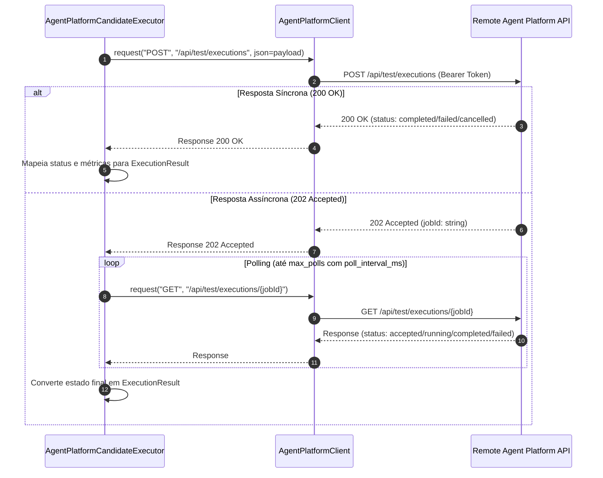

# Integração Agent Platform e Execução de Candidatos

A integração com a **Agent Platform** fornece os componentes adaptadores que conectam o sistema Harness Lab às APIs de runtime e repositórios de agentes. O adaptador gerencia a inspeção de capacidades, a captura e preservação imutável de snapshots de harness (`HarnessSnapshot`), a execução de baselines e versões candidatas sobre casos de teste, e o mapeamento determinístico de resultados de execução.

Os componentes adaptadores residem no módulo `src/harness_lab/adapters/agent_platform/` e estendem as portas de domínio definidas em `src/harness_lab/domain/ports.py`.

---

## Arquitetura e Fluxo de Execução

A arquitetura da integração é dividida em três responsabilidades principais:
1. **Cliente HTTP Sanitizado (`AgentPlatformClient`)**: Gerencia o transporte HTTP, autenticação Bearer token, validação de URLs e tratamento sanitizado de exceções.
2. **Repositório de Harness (`AgentPlatformHarnessRepository`)**: Consulta capacidades e descobre o estado atual do agente, normalizando componentes conhecidos e preservando o payload completo original em `opaque_payload`.
3. **Executor de Candidatos (`AgentPlatformCandidateExecutor`)**: Despacha requisições de teste para o ambiente remoto, lidando com execuções síncronas (HTTP 200) e assíncronas (HTTP 202 com polling).

*Figura 1: Sequência de despacho e polling de execução de candidatos na Agent Platform.*

---

## Cliente HTTP Sanitizado (`AgentPlatformClient`)

Implementado em `src/harness_lab/adapters/agent_platform/client.py`, o `AgentPlatformClient` é responsável por emitir chamadas HTTP seguras para a API remota.

### Comportamento e Invariantes

* **Validação de Esquema**: O construtor valida o parâmetro `base_url` utilizando `urllib.parse.urlparse`. Caso o esquema não seja `http` ou `https`, levanta imediatamente `ValueError("AGENT_PLATFORM_URL_INVALID")`.
* **Autenticação e Cabeçalhos**: Cada requisição injeta automaticamente o cabeçalho `authorization: Bearer <token>` e `accept: application/json`. Cabeçalhos adicionais passados nas chamadas são mesclados sem sobrescrever a autenticação base, a menos que especificado.
* **Sanitização de Falhas**: Exceções de rede do `httpx.HTTPError` são capturadas e convertidas em `RuntimeError("AGENT_PLATFORM_REQUEST_FAILED")`. Isso garante que detalhes sensíveis de infraestrutura ou tokens remotos não sejam expostos em logs não sanitizados.
* **Injeção de Transporte**: Aceita um parâmetro opcional `transport` (`httpx.AsyncBaseTransport`), permitindo a injeção de mocks (`httpx.MockTransport`) em testes herméticos unitários.

---

## Repositório de Harness e Preservação de `opaque_payload`

Implementado em `src/harness_lab/adapters/agent_platform/harness_repository.py` e suportado por `src/harness_lab/adapters/agent_platform/capabilities.py`, o repositório recupera e encapsula as definições operacionais dos agentes.

### Mapeamento de Capacidades (`AgentCapabilities`)

A rota `/api/agents/{agent_id}/capabilities` retorna as capacidades da plataforma remota:
* O módulo `capabilities.py` expõe `_EDITABLE_COMPONENTS = ("dta-flow", "tools", "parameters", "knowledge", "memory", "records")`.
* A função `map_agent_capabilities` extrai a lista `editable`, filtrando apenas os componentes reconhecidos pelo Harness Lab. Componentes futuros ou desconhecidos presentes na resposta remota são ignorados na tupla `editable_components`.
* As flags `supportsSeed` e `supportsToolReplay` são mapeadas como booleanos, e a versão de API remota é capturada em `DiscoveredAgentCapabilities.api_version`.
* Respostas com HTTP 401 ou 403 são sanitizadas e disparam `RuntimeError("AGENT_PLATFORM_INVALID_CREDENTIALS")`.

### Captura de Snapshot e `opaque_payload`

A rota `/api/agents/{agent_id}/harness` retorna o estado estruturado do agente. Durante a conversão para `HarnessSnapshot`:
1. **Mapeamento de Componentes**: Os campos `dtaFlow`, `tools`, `parameters`, `knowledge`, `memory` e `records` presentes no JSON remoto são serializados de volta para strings JSON canônicas e armazenados no dicionário `snapshot.components`.
2. **Hash de Artefato (`artifact_hash`)**: É calculado o hash SHA-256 (hexadecimal de 64 caracteres) sobre a representação string JSON canônica do payload completo (`json.dumps(raw, ensure_ascii=False, separators=(",", ":"))`).
3. **Preservação do Payload Opaco (`opaque_payload`)**: Para evitar perda de normalização e garantir a fidelidade total do modelo do fornecedor, todo o dicionário JSON retornado é copiado e convertido em uma estrutura profundamente imutável (`MappingProxyType` e tuplas imutáveis em `_deep_immutable`) e atribuído a `snapshot.opaque_payload`.
4. **Campos Não Mapeados**: Quaisquer atributos remotos ausentes na especificação do Harness Lab (por exemplo, `futureField` ou metadados de plataformas de terceiros) permanecem intactos em `opaque_payload`, permitindo reconstrução idêntica e comparações de diff sem perda de dados.

---

## Execução de Candidatos e Baseline (`AgentPlatformCandidateExecutor`)

Implementado em `src/harness_lab/adapters/agent_platform/candidate_executor.py`, o `AgentPlatformCandidateExecutor` gerencia a execução de requisições do tipo `BaselineExecutionRequest` ou `CandidateVersionExecutionRequest`.

### Despacho de Requisição (`POST /api/test/executions`)

Ao despachar um teste, o executor constrói um payload JSON contendo:
* `environment`: `"test"`
* `roundId`: ID da rodada em execução (`request.round_id`).
* `caseId`: ID do caso de teste (`request.case_id`).
* `harnessVersionId`: ID do snapshot de harness (`request.harness_version_id`).
* `attempt`: Número da tentativa (`request.attempt`).
* `correlationId`: Chave de idempotência (`request.idempotency_key`).
* `candidateId`: Incluído apenas se `request.kind == "candidate"`.

Adicionalmente, o cabeçalho `idempotency-key` é enviado com a chave de idempotência. O executor **não envia** o campo `publish` no corpo da requisição de teste.

### Modos de Resposta e Polling

| Status HTTP | Condição / Fluxo | Processamento no Executor |
| :--- | :--- | :--- |
| **200 OK** | Resposta síncrona imediata | Converte a resposta remota diretamente em `ExecutionResult`. |
| **202 Accepted** | Resposta assíncrona com `jobId` | Inicia loop de polling na rota `/api/test/executions/{job_id}`. Aguarda `poll_interval_ms` (padrão: 500ms) entre chamadas por até `max_polls` tentativas (padrão: 20). Continua o polling enquanto o status remoto for `"accepted"` ou `"running"`. |
| **Timeout (Polling)** | Estouro do limite `max_polls` | Retorna `ExecutionStatus` `"timed_out"` com limitação `("AGENT_PLATFORM_JOB_TIMEOUT",)`. |
| **Erro HTTP / Falha** | Erro de rede ou HTTP 5xx/4xx | Retorna `ExecutionStatus` `"integration_failed"` com limitação `("AGENT_PLATFORM_REQUEST_FAILED",)`. |

### Mapeamento de Estados Finais (`ExecutionStatus`)

Quando a execução remota é finalizada, o payload final é mapeado para o modelo `ExecutionResult`:

* **`completed` (com `traceId`)**: Mapeado para status `"succeeded"`.
* **`completed` (sem `traceId`)**: Mapeado para status `"trace_missing"` com a limitação `("TRACE_CORRELATION_PENDING",)`.
* **`failed`**: Mapeado para status `"agent_failed"`.
* **`cancelled`**: Mapeado para status `"cancelled"`.

As métricas de execução (`latencyMs`, `inputTokens`, `outputTokens`, `cost`) são extraídas e encapsuladas no objeto `ExecutionMetrics`.

---

## Status dos Contratos de Rede e Limitações Operacionais

Conforme documentado em `docs/integracoes.md` e `docs/limites.md`, a integração com a Agent Platform possui restrições importantes em relação ao ambiente de produção:

1. **Contratos de Rede Não Confirmados**: Os caminhos de API `/api/agents/:id/capabilities`, `/api/agents/:id/harness` e `/api/test/executions` estão definidos estaticamente nos adaptadores. Atualmente, esses endpoints são validados exclusivamente por fixtures de teste herméticas com `httpx.MockTransport`.
2. **Cadastro e Cifragem Local**: O cadastro de uma plataforma de agentes no backend valida apenas o formato da URL e armazena os tokens de forma cifrada. O sistema indica `configured: true` apenas para confirmar o registro local, **sem realizar validação remota de autenticação ou handshake ativo**.
3. **Ausência de Smoke Tests Reais**: Não há flag ou suíte de teste de fumaça contra ambientes reais de staging/produção implementada no momento.
4. **Requisitos para Produção**: Antes de habilitar o provider contra um ambiente real, deve-se obter a especificação OpenAPI/Swagger oficial do ambiente, validar endpoints, esquemas de payload, semântica de versões/candidatos e políticas de correlação de traces.

---

## Suíte de Testes e Validação Hermética

A integração é coberta por testes unitários em `tests/unit/adapters/agent_platform/`:

* **`test_client.py`**: Valida o uso do cabeçalho `Bearer`, tratamento de URLs inválidas e injeção de `httpx.MockTransport`.
* **`test_capabilities.py`**: Garante a filtragem correta dos componentes editáveis e o mapeamento das flags `supportsSeed` e `supportsToolReplay`.
* **`test_harness_repository.py`**: Testa o parse do snapshot, o cálculo do SHA-256 em `artifact_hash`, a conversão imutável e a preservação completa de campos não mapeados no `opaque_payload`.
* **`test_candidate_executor.py`**: Verifica a execução síncrona (200), o polling assíncrono (202), mapeamento de `trace_missing`, estouro de timeout e sanitização de exceções remotas.

Para mais detalhes sobre a orquestração de rodadas e a execução distribuída por workers, consulte [Runtime do Worker](../operations/worker-runtime.md), [Refinamento e Avaliação](../workflows/evaluation-refinement.md) e [Modelo de Domínio](../architecture/domain-model.md).
