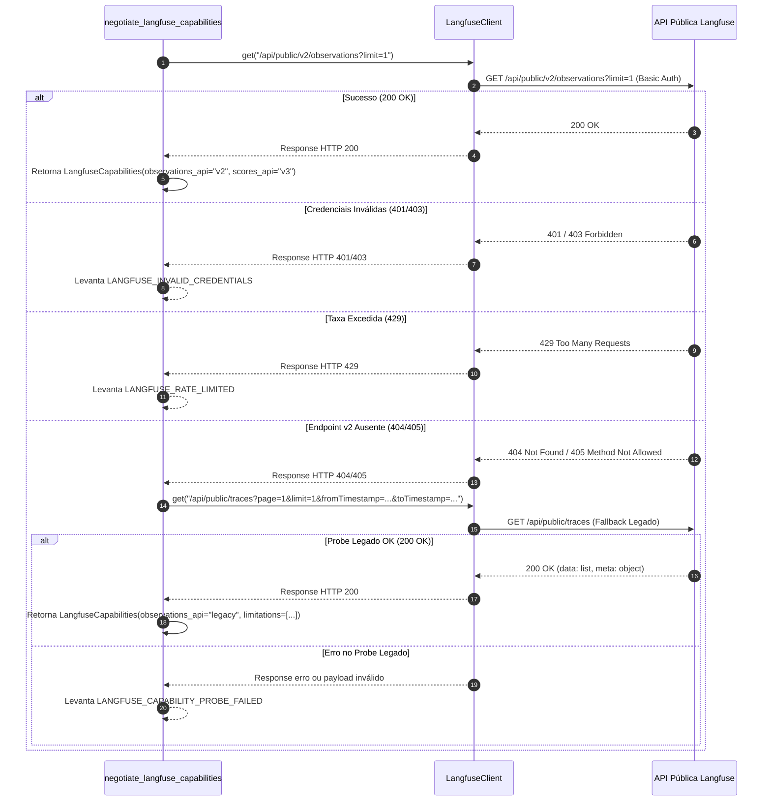

# Integração Langfuse (Traces e Casos)

A integração com a plataforma **Langfuse** fornece os adaptadores responsáveis por conectar o **Harness Lab** às APIs públicas do Langfuse. O adaptador cobre duas finalidades estratégicas principais:

1. **Importação Histórica de Casos de Teste (`LangfuseCaseImportRepository`)**: Recupera traces de execuções históricas do agente no Langfuse, filtra e classifica cada trace individualmente quanto à viabilidade de reutilização, gera prévias temporárias em memória (`LangfuseImportPreviewStore`) e persiste novos casos de teste (`CaseId`) com identificadores determinísticos.
2. **Ingestão de Evidências de Execução (`LangfuseTraceRepository`)**: Coleta observações e traces gerados durante as rodadas de teste, normalizando os dados em estruturas homogêneas de evidência (`EvidenceTrace`) associadas a cada caso e rodada de avaliação.

Todos os componentes da integração residem no diretório `src/harness_lab/adapters/langfuse/` e interagem com os modelos e portas da camada de domínio definidos em `src/harness_lab/domain/`.

---

## Arquitetura e Componentes da Integração

A integração é estruturada em cinco componentes principais desacoplados:

- **`LangfuseClient`** (`src/harness_lab/adapters/langfuse/client.py`): Cliente HTTP assíncrono sobre `httpx.AsyncClient` com suporte a autenticação Basic Auth (chaves pública e secreta codificadas em Base64), validação estrita do esquema de URL (`http`/`https`), controle de timeout configurável (padrão 5.000 ms) e conversão sanitizada de exceções de rede em `RuntimeError("LANGFUSE_REQUEST_FAILED")`.
- **`negotiate_langfuse_capabilities`** (`src/harness_lab/adapters/langfuse/capabilities.py`): Mecanismo de sondagem que inspeciona a instância remota para detectar o suporte à **Observations API v2** ou realizar o fallback transparente para a **Traces API v1 (legada)**.
- **`normalize_observations`** (`src/harness_lab/adapters/langfuse/normalize.py`): Função utilitária de normalização de dados brutos que converte observações do Langfuse em modelos imutáveis `NormalizedObservation`, descobre a raiz lógica da árvore de execução, calcula latências e detecta limitações de dados (como ausência de métricas de custo ou múltiplos nós raiz).
- **`LangfuseCaseImportRepository` e `LangfuseImportPreviewStore`** (`src/harness_lab/adapters/langfuse/case_import_repository.py`): Repositório e cache temporário para busca, classificação detalhada de traces (prontos vs. descartados por motivos específicos) e geração de prévias antes da gravação de casos.
- **`LangfuseTraceRepository`** (`src/harness_lab/adapters/langfuse/trace_repository.py`): Implementação da porta de domínio `TraceRepository` para consulta e coleta paginada de rastros durante as avaliações do Harness Lab.

---

## Negociação de Capacidades (Capability Negotiation)

A plataforma Langfuse possui diferentes versões de API públicas dependendo da versão da instância remota (cloud ou self-hosted). O adaptador realiza uma negociação automática no momento da inicialização através da função `negotiate_langfuse_capabilities`.


*Fluxo de decisão da negociação de capacidades com verificação do Observations API v2 e fallback para o endpoint legado.*

### Estrutura de Retorno das Capacidades

A sondagem retorna um objeto imutável `LangfuseCapabilities` contendo:
- `observations_api`: `"v2"` quando o endpoint moderno responder com sucesso, ou `"legacy"` quando for utilizado o fallback via `/api/public/traces`.
- `scores_api`: `"v3"` por padrão.
- `supported_filters`: tupla com os filtros disponíveis para consulta (`("fromStartTime", "toStartTime", "traceId", "type", "environment")` para v2; `("fromTimestamp", "toTimestamp")` para legado).
- `probed_at`: registro no formato ISO 8601 UTC do momento da sondagem.
- `limitations`: tupla de avisos operacionais, incluindo alerta explícito quando o fallback para o endpoint legado (depreciado) é ativado.

Se as credenciais forem rejeitadas em qualquer etapa, a negociação interrompe imediatamente a execução lançando `RuntimeError("LANGFUSE_INVALID_CREDENTIALS")`.

---

## Normalização de Observações e Estruturas de Dados

A função `normalize_observations` converte cargas brutas fornecidas pelo Langfuse em instâncias imutáveis de `NormalizedObservation` e consolida estatísticas e limitações do lote.

### Regras de Processamento de Observações

1. **Deduplicação de Chaves**: Itens duplicados com a mesma combinação de `project_id` e `id` de observação são unificados.
2. **Identificação da Raiz Lógica (`logical_root_ids`)**: Uma observação é considerada raiz se não possuir `parent_observation_id` ou se a observação pai referenciada não estiver presente no lote coletado.
3. **Cálculo de Latência**: Quando o campo `end_time` está presente, a latência em milissegundos é calculada pela diferença `_to_millis(end_time) - _to_millis(start_time)`.
4. **Coleta de Limitações**:
   - Referência a pai ausente: adiciona a limitação `"Observation {id} references missing parent {parent_id}."`.
   - Ausência de métricas de consumo: adiciona a limitação `"Observation {id} has missing usage or cost metrics."` se `usage_details` ou `cost_details` forem omitidos.
   - Múltiplas raízes por trace: se um mesmo `trace_id` possuir mais de uma observação raiz, a limitação `"Trace {trace_id} has multiple logical roots."` é registrada.

---

## Importação e Recuperação de Casos (Case Import & Recovery)

O módulo `LangfuseCaseImportRepository` implementa o motor de busca, parsing, sanitização e classificação granular de traces históricos.

### Limites e Restrições de Segurança

Para prevenir exaustão de memória ou ataques de negação de serviço ao ler dados remotos, a importação impõe limites estritos definidos no repositório:

| Constante | Valor | Descrição |
| :--- | :--- | :--- |
| `MAX_IMPORT_LIMIT` | `40` | Quantidade máxima de traces retornados em uma única operação. |
| `MAX_IMPORT_PAGES` | `100` | Limite máximo de páginas percorridas na paginação remota. |
| `MAX_IMPORT_OBSERVATIONS` | `1.000` | Orçamento total máximo de observações lidas por busca. |
| `MAX_IMPORT_RESPONSE_BYTES` | `5 MB` | Tamanho máximo permitido da resposta HTTP descomprimida. |
| `MAX_CONTENT_LENGTH` | `20.000` | Tamanho máximo em caracteres para o payload de entrada (`input`). |
| `MAX_SESSION_ID_LENGTH` | `200` | Limite máximo de caracteres para o identificador da sessão. |
| `MAX_SOURCE_REFERENCE_LENGTH` | `500` | Limite do comprimento da referência combinada de origem. |

### Algoritmo de Classificação de Traces

Cada trace lido do Langfuse passa pelo pipeline de recuperação e recebe o status `"ready"` (pronto para se tornar um caso) ou `"discarded"` (descartado com um motivo explícito).

<!-- openwiki: mermaid parse failed and this diagram was converted to a text fence so it does not break rendering. Fix the diagram source and restore the mermaid fence. Parser error: Heuristic: an unescaped angle bracket inside a label breaks rendering; rephrase the label. -->
```text
flowchart TD
    Start["Trace Recebido do Langfuse"] --> RootCheck{"Possui Observação Raiz?"}
    RootCheck -- Não --> DiscardRoot["Status: discarded<br/>Motivo: MISSING_ROOT"]
    RootCheck -- Sim --> SortObs["Ordena Observações:<br/>1. Raiz primeiro<br/>2. Menor startTime<br/>3. ID da Observação"]
    
    SortObs --> CandidateLoop["Examina Candidato em Ordem"]
    CandidateLoop --> InputCheck{"Input é válido e não-vazio?"}
    InputCheck -- Não --> NextInput["Registra falha: MISSING_USABLE_INPUT / INVALID_CONTENT"]
    InputCheck -- Sim --> DateCheck{"startTime é data ISO válida?"}
    DateCheck -- Não --> NextDate["Registra falha: INVALID_START_TIME"]
    DateCheck -- Sim --> SizeCheck{"Tamanho do Input <= 20.000 chars?"}
    SizeCheck -- Não --> NextSize["Registra falha: CONTENT_TOO_LARGE"]
    SizeCheck -- Sim --> RefCheck{"source_reference + trace_id <= 500 chars?"}
    RefCheck -- Não --> NextRef["Registra falha: SOURCE_REFERENCE_TOO_LARGE"]
    RefCheck -- Sim --> SessionCheck{"session_id normalizado <= 200 chars?"}
    SessionCheck -- Não --> NextSession["Registra falha: INVALID_SESSION_ID"]
    
    SessionCheck -- Sim --> CreateReady["Status: ready<br/>Cria LangfuseCaseImportCandidate"]
    
    NextInput --> MoreCandidates{"Há mais observações?"}
    NextDate --> MoreCandidates
    NextSize --> MoreCandidates
    NextRef --> MoreCandidates
    NextSession --> MoreCandidates
    
    MoreCandidates -- Sim --> CandidateLoop
    MoreCandidates -- Não --> DiscardPriority["Seleciona motivo de descarte por ordem de prioridade"]
    DiscardPriority --> CreateDiscarded["Status: discarded<br/>Motivo selecionado"]
```
*Pipeline determinístico de validação e classificação de traces para recuperação de casos.*

### Determinismo na Geração de IDs

Para evitar a importação duplicada do mesmo trace no mesmo ambiente, o repositório gera a chave do caso (`CaseId`) de forma determinística:

$$\text{case\_id} = \text{"langfuse-"} + \text{sha256}(\text{connection\_id} + \text{":"} + \text{trace\_id})[:64]$$

Essa abordagem garante idempotência: requisições repetidas sobre o mesmo trace e conexão produzem o mesmo `case_id`, permitindo que o sistema identifique se o caso já foi importado no escopo do agente.

### Gerenciamento de Prévias Temporárias (`LangfuseImportPreviewStore`)

Para suportar o fluxo de duas etapas (busca com revisão antes da confirmação de escrita), o repositório utiliza o `LangfuseImportPreviewStore`.
- **TTL de Expiração**: Cada prévia tem validade padrão de 5 minutos (`DEFAULT_PREVIEW_TTL_MS = 300.000 ms`).
- **Capacidade Máxima**: O repositório retém até 100 prévias concorrentes em memória (`DEFAULT_PREVIEW_CAPACITY = 100`). Quando a capacidade é atingida, a prévia com vencimento mais antigo é expurgada automaticamente.
- **Consumo Atômico**: A chamada `.consume(preview_id, trace_ids)` valida a seleção solicitada pelo usuário, extrai os candidatos correspondentes e remove imediatamente o `preview_id` da memória, impedindo reutilização de prévias.

---

## Ingestão de Evidências de Trace durante Avaliações

O módulo `LangfuseTraceRepository` implementa a porta `TraceRepository` para coletar dados durante a execução de rodadas de avaliação no Harness Lab.

### Fluxo de Coleta (`collect`)

1. Recebe uma consulta `TraceQuery` contendo `round_id`, intervalo temporal (`from_`, `to`), `cursor` e `limit`.
2. Para a API v2: consulta `/api/public/v2/observations`, normaliza os itens lidos e constrói instâncias de `EvidenceTrace`:
   - `id`: `EvidenceId(f"{project_id}:{observation.id}")`
   - `round_id`: ID da rodada em execução.
   - `case_id`: `CaseId(observation.trace_id)`
   - `excerpt`: JSON sanitizado (truncado em 1.000 caracteres) contendo `input` e `output`.
3. Para a API legada: consulta `/api/public/traces` e mapeia diretamente os campos `input` e `output` para o trecho (`excerpt`).
4. Realiza o tratamento de limite de taxa (`HTTP 429`): ao receber uma resposta 429, o repositório lê o cabeçalho `Retry-After` (limitado ao máximo de 30 segundos) e faz exatamente uma nova tentativa antes de lançar erro sanitizado.
5. Retorna um objeto `TracePage` com a lista deduplicada de evidências e o cursor da próxima página (`next_cursor`), se houver.

---

## Tratamento de Segurança, Criptografia e Limites de Taxa

A integração foi desenhada para operar com alto padrão de segurança e resiliência:

- **Isolamento de Credenciais**: As chaves públicas e secretas do Langfuse permanecem armazenadas de forma cifrada no banco SQLite do servidor e são descriptografadas apenas durante a inicialização do `LangfuseClient`. Nenhuma chave ou token de autenticação é exposto na API REST ou retornado ao navegador. Para detalhes sobre o armazenamento cifrado de conexões, consulte a documentação de [Configuração e Segurança](../operations/configuration-security.md).
- **Tratamento Sanitizado de Exceções**: Falhas de comunicação HTTP, erros de parsing JSON e respostas fora do padrão são capturados e convertidos em erros genéricos sanitizados (`LANGFUSE_REQUEST_FAILED`, `LANGFUSE_CASE_IMPORT_FAILED`, `LANGFUSE_INVALID_CREDENTIALS`), evitando o vazamento de stack traces internos ou segredos de infraestrutura.
- **Resiliência contra Rate Limit (HTTP 429)**: Tanto a importação de casos quanto a coleta de evidências tratam a resposta `429 Too Many Requests` com retentativa única após aguardar o tempo solicitado no cabeçalho `Retry-After` (respeitando o teto de 30 segundos). Se a retentativa falhar, o erro sanitizado `LANGFUSE_RATE_LIMITED` é propagado.
- **Particionamento de Corpus e Diagnóstico**: Os casos importados do Langfuse são devidamente categorizados por grupos de similaridade (`similarity_group`), permitindo sua utilização em fluxos de particionamento e diagnóstico de avaliação. Para entender o uso de casos importados na suíte de testes, veja o documento de [Particionamento e Diagnóstico de Casos](../workflows/case-partitioning-diagnosis.md).

---

## Cobertura de Testes e Fixtures

A suíte de testes da integração Langfuse é dividida em testes unitários e de integração, garantindo isolamento total de rede externa:

- **`tests/unit/adapters/langfuse/test_client.py`**: Valida a construção de URLs, codificação Base64 de credenciais e mapeamento de exceções HTTP.
- **`tests/unit/adapters/langfuse/test_capabilities.py`**: Testa o fluxo de sondagem para o Observations API v2, fallback para o legado quando v2 retorna 404/405, e tratamento de respostas 401/403/429.
- **`tests/unit/adapters/langfuse/test_normalize.py`**: Garante o comportamento correto da normalização de observações, cálculo de latência, tratamento de raízes ausentes/múltiplas e detecção de limitações de custos.
- **`tests/integration/adapters/langfuse/test_case_import_repository.py`**: Testa a busca paginada, classificação de itens `ready` e `discarded`, limites de tamanho de payload, idempotência na geração de IDs e ciclo de vida do `LangfuseImportPreviewStore`.
- **`tests/integration/adapters/langfuse/test_trace_repository.py`**: Valida a coleta de evidências em lotes paginados e o mecanismo de retry após recepção de HTTP 429.
