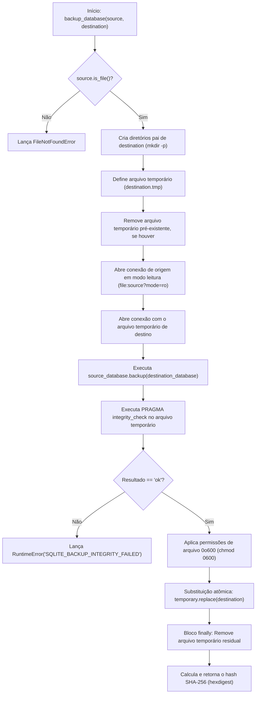
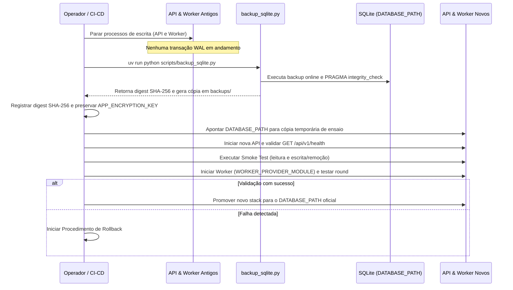

# Procedimentos de Backup, Cutover e Restauração

O **Harness Lab** utiliza o banco de dados relacional [SQLite em modo Write-Ahead Logging (WAL)](../architecture/storage-persistence.md) para armazenar todo o estado persistente da aplicação, incluindo especificações de agentes, histórico de execuções (*rounds*), artefatos, filas de tarefas e logs de auditoria.

Devido à natureza concorrente do ambiente operacional (com a API HTTP e os processos do [Worker Runtime](worker-runtime.md) acessando o mesmo arquivo de banco de dados), os procedimentos de cópia de segurança, migração de versão (*cutover*) e recuperação de falhas (*rollback*) exigem mecanismos estritos de atomicidade, verificação de checksum SHA-256 e controle de permissões de acesso ao arquivo.

---

## Mecanismo de Backup Atômico do SQLite

A cópia de segurança do banco de dados é realizada através do script utilitário `scripts/backup_sqlite.py`. O script utiliza a **SQLite Online Backup API** nativa do driver `sqlite3` do Python (`sqlite3.Connection.backup()`), permitindo extrair snapshots consistentes e pontuais do banco mesmo enquanto conexões de leitura ou escrita estão ativas.

### Fluxo de Execução da Função `backup_database`

A função principal `backup_database(source: Path, destination: Path) -> str` gerencia o ciclo de vida da cópia de segurança através dos seguintes passos operacionais:


Fluxo interno de validação, cópia online via SQLite Backup API, verificação de integridade e substituição atômica no `scripts/backup_sqlite.py`.

1. **Validação de Origem**: Verifica a existência do banco de origem (`source.is_file()`), lançando `FileNotFoundError` se o arquivo for inacessível.
2. **Preparação do Diretório e Arquivo Temporário**: Garante a criação de toda a estrutura de diretórios de destino (`destination.parent.mkdir(parents=True, exist_ok=True)`) e cria uma rota de arquivo temporário com o sufixo `.tmp` (`temporary = destination.with_suffix(destination.suffix + ".tmp")`).
3. **Abertura Segura em Modo Leitura**: Abre a conexão com o banco de origem em modo de leitura URI (`sqlite3.connect(f"file:{source}?mode=ro", uri=True)`), impedindo qualquer alteração no arquivo original durante a operação de leitura.
4. **Cópia Atômica por Backup API**: Executa `source_database.backup(destination_database)`, copiando as páginas do banco de origem para o banco temporário de forma consistente com o arquivo WAL.
5. **Verificação Instantânea de Integridade**: Executa a instrução `PRAGMA integrity_check` diretamente sobre a conexão do banco temporário recém-criado. Caso o retorno seja nulo ou diferente de `("ok",)`, a operação é interrompida imediatamente com a exceção `RuntimeError("SQLITE_BACKUP_INTEGRITY_FAILED")`.
6. **Proteção de Permissões POSIX (0600)**: Aplica a máscara de permissão `0o600` (`temporary.chmod(0o600)`), garantindo que apenas o proprietário do processo tenha permissão de leitura e escrita. Isso previne o acesso não autorizado a dados sensíveis contidos no SQLite (como casos de teste, resultados em claro e chaves de sessão).
7. **Substituição Atômica no Destino**: Substitui atomicamente o arquivo temporário pelo caminho final de destino (`temporary.replace(destination)`).
8. **Limpeza e Checksum SHA-256**: No bloco `finally`, assegura a remoção de resíduos do arquivo temporário (`temporary.unlink(missing_ok=True)`) e calcula o digest SHA-256 do arquivo final (`hashlib.sha256(destination.read_bytes()).hexdigest()`).

### Interface de Linha de Comando (CLI)

O script expõe uma CLI operável via `uv run`:

```bash
uv run python scripts/backup_sqlite.py "$DATABASE_PATH" backups/harness-cutover.sqlite
```

A saída gerada no terminal segue o padrão estandardizado de checksum:

```text
sha256:e3b0c44298fc1c149afbf4c8996fb92427ae41e4649b934ca495991b7852b855  backups/harness-cutover.sqlite
```

---

## Validação Automatizada e Cobertura de Testes

A integridade e as garantias operacionais do script de backup são verificadas continuamente pela suíte de testes de integração no arquivo `tests/integration/test_sqlite_backup.py`.

O teste `test_backup_is_consistent_private_and_writable_copy` simula um ambiente real de produção:
- Cria um banco de dados SQLite de origem em modo WAL (`PRAGMA journal_mode=WAL`).
- Cria uma tabela `records` e insere dados pré-existentes (`before-backup`).
- Executa o script `scripts/backup_sqlite.py` via subprocesso CLI.
- Valida que a saída no `stdout` inicia com o prefixo `sha256:` seguido por uma string hexadecimal de exatamente 64 caracteres.
- Valida que a máscara de permissões do arquivo gerado corresponde a `0o600` (`destination.stat().st_mode & 0o777 == 0o600`).
- Conecta-se à cópia de backup, confirma que `PRAGMA integrity_check` retorna `("ok",)`, verifica que os dados gravados antes do backup estão presentes e realiza uma inserção de teste (`smoke-write`) para comprovar que o arquivo de backup é uma cópia independente e gravável.

---

## Procedimento de Cutover em Produção

O procedimento de *cutover* deve ser executado sempre que houver uma atualização de versão do código da aplicação, alteração na infraestrutura ou execução de migrações de esquema no SQLite.

### Roteiro Passo a Passo para Cutover


Sequência de operações para ensaio e execução do cutover com verificação de saúde e integridade.

1. **Parada dos Escritores**: Paralisar todas as instâncias ativas da API HTTP e do Worker Runtime para garantir estagnação de escritas durante a geração do snapshot base.
2. **Geração do Backup Consistente**:
   ```bash
   uv run python scripts/backup_sqlite.py "$DATABASE_PATH" backups/harness-cutover.sqlite
   ```
3. **Registro do Checksum e Chave de Criptografia**:
   - Registre o hash SHA-256 impresso no terminal.
   - Guarde em local seguro a chave de criptografia configurada na variável de ambiente `APP_ENCRYPTION_KEY` (chave Base64 de 32 bytes). Os arquivos de backup e as tabelas do SQLite podem conter dados de casos e resultados em claro; aplique restrição de acesso a todo o volume.
4. **Configuração do Ambiente de Ensaio**:
   - Copie a cópia de segurança para um diretório temporário de homologação.
   - Ajuste a variável de ambiente `DATABASE_PATH` para apontar para essa cópia de ensaio.
5. **Validação da API e Smoke Test**:
   - Inicie a API Python (`uv run harness-lab api`).
   - Consulte o endpoint de saúde `GET /api/v1/health` para validar a prontidão do serviço.
   - Realize consultas de leitura de entidades e execute um teste de fumaça (*smoke test*) criando e removendo um registro temporário.
6. **Validação do Worker Runtime**:
   - Inicie o worker configurado com o provedor homologado (`WORKER_PROVIDER_MODULE`).
   - Valide a retomada e conclusão de uma rodada controlada de avaliação (*round*).
7. **Liberação Final**:
   - Assegure que nenhum processo antigo ou script legado em Python permaneça escrevendo no banco.
   - Promova o novo stack para atender o tráfego de produção.

---

## Estratégia e Roteiro Objetivo de Rollback

O *rollback* é o procedimento de emergência acionado quando uma falha crítica é identificada durante ou imediatamente após o cutover.

### Gatilhos de Acionamento do Rollback

O operador deve interromper a implantação e disparar o rollback caso ocorra qualquer um dos seguintes cenários:
- A API Python falha ao inicializar.
- A validação de integridade do SQLite (`PRAGMA integrity_check`) ou os checksums de migração em `schema_migrations` falham.
- Os segredos e credenciais de conexões não podem ser descriptografados (falha na chave `APP_ENCRYPTION_KEY`).
- Os *jobs* em second plano ou *checkpoints* de execução não são retomados pelo Worker.
- O *smoke test* de leitura ou escrita falha na API.

### Invariantes e Regra de Viabilidade do Rollback

> **ATENÇÃO - INVARIANTE FUNDAMENTAL DE ROLLBACK**:
> 1. **Nunca permita dois stacks escrevendo simultaneamente** no mesmo arquivo de banco de dados.
> 2. O rollback para a versão de software anterior é **permitido apenas se a nova versão do Python ainda não tiver gravado um formato de dados ou esquema de migração incompatível** no SQLite.
> 3. Caso o novo código já tenha aplicado migrações de banco incompatíveis com o stack anterior, o rollback de código é **proibido**. O operador deve manter o banco migrado e efetuar a **correção em avanço (*forward fix*)**.

### Procedimento Passo a Passo para Rollback

Quando a condição de viabilidade for satisfeita, o operador deve executar os seguintes comandos com ambos os runtimes (antigo e novo) completamente parados:

```bash
# 1. Parar imediatamente API e Worker de ambos os stacks (garantir zero escritas)
# 2. Preservar o banco falho para análise forense posterior (não sobrescrever)
mv "$DATABASE_PATH" "$DATABASE_PATH.failed-$(date +%Y%m%d%H%M%S)"

# 3. Restaurar a cópia do backup ensaiado e verificado durante o cutover
cp backups/harness-cutover.sqlite "$DATABASE_PATH"

# 4. Confirmar a integridade física do banco restaurado antes de abrir conexões
uv run python -c "import sqlite3,sys; c=sqlite3.connect(sys.argv[1]); print(c.execute('PRAGMA integrity_check').fetchone()[0])" "$DATABASE_PATH"
```

Após a restauração física e a confirmação de que o retorno do `PRAGMA integrity_check` é `ok`:
1. Restaure a mesma chave de criptografia `APP_ENCRYPTION_KEY` utilizada no momento em que o backup foi gerado.
2. Reinicie exclusivamente o runtime e a versão do código homologados anteriormente.
