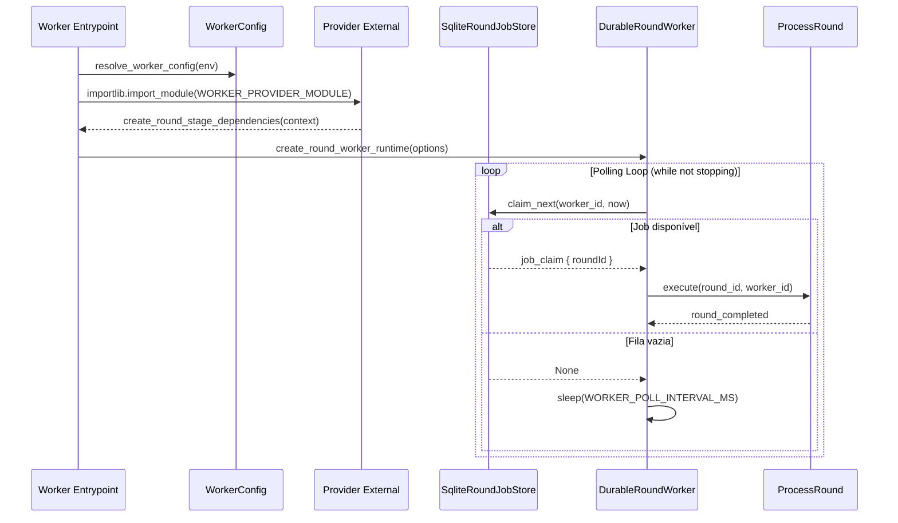

# Runtime do Worker Durável e Providers

O **DurableRoundWorker** é o componente de processamento em segundo plano do Harness Lab responsável por executar o pipeline assíncrono de otimização de agentes ([Round Pipeline](../workflows/round-pipeline.md)). Ele opera de forma desacoplada da API HTTP FastAPI, consumindo trabalhos persistidos em banco de dados SQLite por meio de um mecanismo resiliente de *polling* e *job leases*.

Este documento detalha o funcionamento interno do runtime do worker, o ciclo de vida e concorrência dos jobs, o mecanismo de injeção de dependências via `WORKER_PROVIDER_MODULE`, o encerramento gracioso (*graceful shutdown*) e as estratégias de recuperação de falhas (*crash recovery*).

---

## Visão Geral e Papel Arquitetural

No arranjo arquitetural do sistema ([System Overview](../architecture/system-overview.md)), a API REST/SSE é responsável por registrar e enfileirar solicitações de rodadas, enquanto o worker executa as fases intensivas de coleta de evidências, diagnósticos, geração de propostas, execuções comparativas e exportação de resultados.


*Fluxo de inicialização, carregamento de provedor dinâmico, loop de polling e delegação de execução ao ProcessRound.*

O repositório do Harness Lab não embute um provedor de produção de plataformas externas de agentes (como adaptadores específicos de APIs proprietárias). A camada de aplicação define o contrato e os estágios, mas as integrações reais de coleta de traces, execução de modelos e exportação de relatórios devem ser fornecidas externamente via contrato de provider.

---

## Injeção de Dependências e Contrato do Provider (`WORKER_PROVIDER_MODULE`)

A inicialização do worker é gerenciada pela função `start_worker` em `src/harness_lab/worker/main.py`. O worker verifica a presença da variável de ambiente `WORKER_PROVIDER_MODULE`.

### Comportamento sem Provider
Se `WORKER_PROVIDER_MODULE` não estiver definido (valor `None`), `start_worker` retorna `False` imediatamente e **não abre o banco de dados SQLite**. O processo finaliza suavemente ou permanece inativo sem reivindicar nenhum job da fila.

### Carregamento Dinâmico
Quando `WORKER_PROVIDER_MODULE` é especificado com um caminho de arquivo Python válido (relativo ou absoluto), o runtime utiliza `importlib.util` para carregar o módulo em tempo de execução. O módulo deve expor obrigatoriamente uma função chamada `create_round_stage_dependencies`.

```python
# Assinatura esperada do módulo de provider externo
def create_round_stage_dependencies(
    context: dict[str, str]
) -> dict[str, Any] | Awaitable[dict[str, Any]]:
    ...
```

O argumento `context` repassado à fábrica do provider contém:
- `database_path`: Caminho absoluto para o banco de dados SQLite (`harness.sqlite`).
- `encryption_key`: Chave mestre de cifragem configurada via `APP_ENCRYPTION_KEY`.

### Dependências dos Estágios (`RoundStageDependencies`)
A função do provider deve retornar um dicionário ou objeto contendo as implementações dos adaptadores de estágio necessários:

- `traces`: Objeto com o método `collect(round, diagnosis_cases)` para coletar traces e evidências no ambiente externo (ex.: Langfuse).
- `harnesses`: Repositório de snapshots e capacidades do agente (`fetch_snapshot`).
- `proposals`: Gerador de propostas de otimização (`create`).
- `executor`: Executor de cenários baseline e candidatos (`execute`).
- `evaluator`: Avaliador e calculador de métricas de recomendação.
- `exportRound`: Função de exportação e persistência de relatórios e artefatos finais.
- `cases` *(Opcional)*: Mecanismo de consulta de casos de teste. Se omitido pelo provider, o runtime (`create_round_worker_runtime` em `src/harness_lab/worker/runtime.py`) injeta automaticamente uma implementação fallback (`_collect_cases`) que consulta a tabela de casos do SQLite via `SqliteCaseRepository`.

---

## Ciclo de Sondagem, Concorrência e Leases de Trabalho

O gerenciamento de jobs na fila SQLite é realizado pelo repositório `SqliteRoundJobStore` (`src/harness_lab/adapters/sqlite/round_job_store.py`) e orquestrado por `DurableRoundWorker` (`src/harness_lab/worker/worker.py`).

### Ciclo de Vida do Job

<!-- openwiki: mermaid parse failed and this diagram was converted to a text fence so it does not break rendering. Fix the diagram source and restore the mermaid fence. Parser error: Heuristic: an unescaped angle bracket inside a label breaks rendering; rephrase the label. -->
```text
stateDiagram-v2
    [*] --> queued: API enfileira round (enqueue)
    queued --> claimed: claim_next (worker_id, lease 30s)
    claimed --> [*]: complete (sucesso ou falha tratada)
    claimed --> cancel_requested: request_cancellation (API)
    cancel_requested --> [*]: complete (cancelamento efetuado)
    claimed --> queued: Expiracao de lease (claimed_at < cutoff)
```
*Estados do trabalho na tabela round_jobs e transições gerenciadas por leases e cancelamentos.*

### Mecanismo de Lease (Job Ownership)
Para garantir concorrência segura entre múltiplas instâncias do worker sem dependência de um broker externo (como Redis ou RabbitMQ), o sistema utiliza a tabela `round_jobs` no SQLite com uma janela de lease padrão de **30 segundos** (`30_000` ms).

A chamada `claim_next(worker_id, now)` busca a rodada elegível mais antiga (`ORDER BY created_at, round_id LIMIT 1`) que atenda a uma das três condições:
1. `status = 'queued'`
2. `status = 'cancel_requested'` e `claimed_by IS NULL`
3. `status IN ('claimed', 'cancel_requested')` e `claimed_at < lease_cutoff` (onde `lease_cutoff = now - 30s`)

A reivindicação é executada em uma única transação atômica SQLite utilizando `UPDATE ... RETURNING`. O worker grava seu `worker_id` no campo `claimed_by` e atualiza `claimed_at` com o carimbo de data/hora atual.

### Loop Principal de Execução
No loop de polling em `main.py`:
- `await runtime.tick()` é executado repetidamente.
- Se `tick()` reivindica e processa um job com sucesso (retorna `True`), o worker inicia a próxima iteração imediatamente, maximizando o vazão.
- Se a fila estiver vazia (`tick()` retorna `False`), a tarefa aguarda o intervalo configurado em `WORKER_POLL_INTERVAL_MS` (padrão de 1000 ms) via `asyncio.sleep`.

---

## Execução do Pipeline e Validação de Lease (`ProcessRound`)

A lógica de transição de estados do pipeline de rodadas é executada pela classe `ProcessRound` (`src/harness_lab/application/rounds/process_round.py`).

### Transições de Estado Sequenciais
O processamento segue rigorosamente a sequência de estados:
1. `setup` → evento `collection_started` → estágio `collect` → estado `collecting`
2. `collecting` → evento `diagnosis_started` → estágio `diagnose` → estado `diagnosing`
3. `diagnosing` → evento `refinement_started` → estágio `refine` → estado `refining`
4. `refining` → evento `execution_started` → estágio `execute` → estado `executing`
5. `executing` → evento `evaluation_started` → estágio `evaluate` → estado `evaluating`
6. `evaluating` → evento `export_started` → estágio `export` → estado `exporting`
7. `exporting` → evento terminal (`recommendation_completed`, `no_recommendation` ou `rollback_completed`)

### Verificação Contínua de Posse do Lease
Entre cada estágio e antes de comitar transições de progresso, `ProcessRound` invoca `_ensure_owned(round_id, worker_id)`. Esse método consulta `SqliteRoundJobStore.is_owned_by(round_id, worker_id)`.

- Se o job tiver tido seu lease expirado e sido tomado por outro worker (por exemplo, devido a um travamento temporário do processo por mais de 30 segundos), `_ensure_owned` lança a exceção `RuntimeError("ROUND_CLAIM_LOST")`.
- Ao capturar `ROUND_CLAIM_LOST`, o worker atual aborta a execução imediatamente sem atualizar o estado da rodada nem deletar o job do banco, permitindo que a nova instância com o lease válido assuma o controle com segurança.

---

## Encerramento Gracioso e Cancelamento

### Graceful Shutdown (Sinais SIGINT e SIGTERM)
Durante a inicialização em `start_worker`, o runtime registra manipuladores para os sinais de interrupção do sistema operacional (`SIGINT` e `SIGTERM`) no loop de eventos assíncrono.

Quando um sinal de encerramento é recebido:
1. A flag local `stopping` é alterada para `True`.
2. A execução da iteração atual do `tick()` (se houver uma rodada em processamento) continua até a conclusão do estágio ativo ou comito da transição.
3. O loop `while not stopping` termina sem iniciar novas reivindicações de jobs.
4. O bloco `finally` garante que o banco de dados SQLite (`database.close()`) seja fechado adequadamente.

### Solicitação de Cancelamento
A API ou administradores podem solicitar a interrupção de uma rodada chamando `request_cancellation(round_id, now)`. Isso atualiza o status do trabalho na tabela `round_jobs` para `cancel_requested`.

Em `ProcessRound.execute`:
- Antes de iniciar qualquer estágio e imediatamente após a conclusão de cada estágio, o worker verifica `await jobs.is_cancellation_requested(round_id)`.
- Se a solicitação for detectada, o worker grava o evento `cancel_requested`, atualiza o estado final da rodada no repositório e remove o job da fila via `jobs.complete(round_id, worker_id)`.

---

## Recuperação contra Falhas (Crash Recovery & Re-claiming)

Se o processo do worker for interrompido abruptamente (ex.: *Out-Of-Memory*, interrupção de energia ou envio de `SIGKILL`):

1. **Expiração Automática**: O job permanece gravado na tabela `round_jobs` com status `'claimed'` e o `claimed_at` antigo.
2. **Reivindicação por Novo Worker**: Decorridos 30 segundos (`lease_ms`), a consulta em `claim_next` considera o job novamente elegível (`claimed_at < lease_cutoff`). Uma nova instância do worker reivindica o job e assume a execução.
3. **Reativação a partir do Último Checkpoint**: Ao executar `ProcessRound.execute`, o worker consulta a rodada no `SqliteRunRepository`. Como cada transição de estágio comita atomicamente um `RoundCheckpoint` no banco de dados, o processamento retoma exatamente a partir do último estado confirmado.
4. **Recuperação da Fase de Exportação (`exporting`)**: Se a falha ocorreu enquanto a rodada estava no estado `exporting`, o mecanismo de recuperação invoca `get_completion_event(round_obj)` no estágio de exportação para inspecionar os artefatos já salvos e determinar a decisão terminal (por exemplo, `rejection_completed`) sem reexecutar os testes de diagnóstico ou avaliações comparativas.

---

## Configuração Operacional e Variáveis de Ambiente

A classe `WorkerConfig` em `src/harness_lab/worker/config.py` gerencia as opções operacionais do worker, carregando-as a partir do ambiente com validações estritas de tipo e limites.

| Variável de Ambiente | Valor Padrão | Validação / Faixa | Descrição |
| :--- | :--- | :--- | :--- |
| `APP_ENCRYPTION_KEY` | *(Obrigatório)* | Base64 canônico de 32 bytes | Chave mestra para cifragem/decifragem de segredos e credenciais de provedores ([Configuration & Security](configuration-security.md)). |
| `WORKER_PROVIDER_MODULE` | `None` | Caminho de arquivo `.py` | Módulo Python contendo a fábrica de dependências `create_round_stage_dependencies`. Se omitido, o worker permanece inativo. |
| `APP_DATA_DIR` | `./data` | Diretório no sistema | Diretório base para armazenamento do arquivo SQLite (`data/harness.sqlite`). |
| `WORKER_ID` | `worker-{pid}` | String não vazia | Identificador único desta instância do worker para controle de leases na tabela `round_jobs`. |
| `WORKER_POLL_INTERVAL_MS` | `1000` | `100` a `60_000` ms | Tempo de espera (em milissegundos) entre sondagens quando a fila de trabalhos estiver vazia. |
| `ROUND_PARTITION_SEED` | `round-partition-v1` | String de semente | Semente determinística utilizada no particionamento e orçamento de partições por rodada. |
| `ROUND_MINIMUM_RESERVED` | `1` | `1` a `100` | Quantidade mínima de partições reservadas no orçamento do worker. |
| `ROUND_RESERVED_RATIO` | `0.2` | `0.0 < ratio < 1.0` | Proporção de partições reservadas no orçamento do worker. |
| `ROUND_MAX_PROPOSALS` | `3` | `1` a `20` | Limite máximo de propostas avaliadas concorrentemente em uma única rodada. |

---

## Testes de Referência do Worker

Os comportamentos centrais do runtime e do worker durável são cobertos por suítes de testes automatizados no repositório:

- **Processamento Unitário de Jobs**: `tests/unit/worker/test_worker.py` garante que `DurableRoundWorker.tick()` processe exatamente um job reivindicado por vez e retorne `False` quando a fila estiver vazia.
- **Carregamento e Sinalização no Main**: `tests/unit/worker/test_main.py` valida o comportamento de inicialização, garantindo que `start_worker` retorne `False` quando `WORKER_PROVIDER_MODULE` estiver ausente, rejeite arquivos inválidos lançando `WORKER_PROVIDER_MODULE_INVALID`, suporte fábricas assíncronas e feche a conexão com o banco de dados SQLite ao receber sinais de interrupção ou em caso de exceção no runtime.
- **Recuperação de Interrupções e Checkpoints**: `tests/integration/test_worker_recovery.py` verifica que `ProcessRound` consiga retomar rodadas interrompidas no estado `exporting`, inferindo o resultado terminal a partir dos artefatos salvos sem duplicar o processamento anterior.
