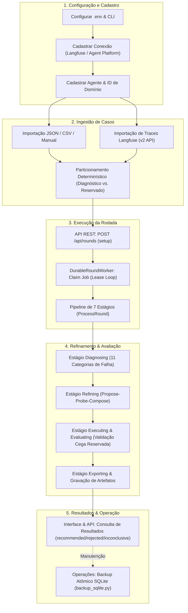

# Visão Geral e Guia de Navegação do Harness Lab

O **Harness Lab** é uma plataforma em Python projetada para o diagnóstico automatizado, refinamento iterativo e avaliação segura e determinística de agentes de Inteligência Artificial Generativa baseados em Grandes Modelos de Linguagem (LLMs).

A plataforma substitui o desenvolvimento tradicional de agentes — focado em tentativa e erro *ad-hoc* em engenharia de prompts — por uma metodologia de engenharia contínua, auditável e imune ao sobreajuste (*overfitting*). Fundamentado no framework **Harness2 (Google Research)**, o Harness Lab introduz isolamento estrito entre os dados de diagnóstico visíveis e as amostras reservadas para validação cega, uma taxonomia rigorosa de falhas e governança sobre o ciclo de vida de otimização de agentes.

---

## 1. Proposta de Valor Principal

O Harness Lab foi construído para resolver os três principais desafios na operação de agentes de IA em escala: **imprevisibilidade de desempenho**, **custos operacionais elevados** e **risco de regressão não detectada**.

* **Diagnóstico Automatizado e Estruturado**: Classifica erros de execução em uma taxonomia estrita de 11 categorias de falhas (`RULE_VIOLATION`, `MISSING_TOOL`, `UNNECESSARY_TOOL`, `INVALID_TOOL_PARAMETERS`, `UNSUPPORTED_ANSWER`, `CONTEXT_FAILURE`, `REPETITION`, `COST_LIMIT_EXCEEDED`, `LATENCY_LIMIT_EXCEEDED`, `INFRASTRUCTURE_FAILURE` e `TOOL_FAILURE`).
* **Isolamento de Falhas de Infraestrutura**: Falhas de rede ou de integrações externas (`INFRASTRUCTURE_FAILURE` e `TOOL_FAILURE`) são categorizadas como `NON_HARNESS_CATEGORIES`, orientando o time a reparar a infraestrutura antes de modificar desnecessariamente os prompts do agente.
* **Prevenção Rigorosa contra Overfitting**: Os casos de teste são particionados de forma determinística em conjuntos de **Diagnóstico** (utilizados para propor hipóteses de melhoria) e conjuntos **Reservados** (selados e acessíveis exclusivamente para a avaliação final).
* **Segurança e Proteção de Dados**: Sanitização automática de logs e evidências (`Redactor` e `_sanitize_excerpt`), criptografia autenticada de credenciais com Fernet/AES-256 (`EncryptedSecretStore`) e preservação de campos não reconhecidos (`opaquePayload`).

Para entender em profundidade o impacto de negócio e o embasamento acadêmico da plataforma, consulte [Valor de Negócio do Harness Lab](concepts/business-value.md) e [Framework Harness2 e Metodologia de Avaliação](concepts/harness2-framework.md).

---

## 2. Início Rápido (Quickstart)

### Requisitos de Sistema

* **Python**: 3.12 ou 3.13;
* **Gerenciador de Dependências**: `uv` 0.12 ou superior;
* **Navegador Headless**: Chromium (necessário para a suíte de testes E2E com Playwright).

### Instalação e Execução Local

1. **Sincronizar dependências e ambiente**:
   ```bash
   uv sync --frozen
   cp .env.example .env
   ```

2. **Iniciar o Servidor API e a Interface Web**:
   ```bash
   uv run harness-lab api
   ```
   A interface web e a API REST estarão disponíveis em `http://127.0.0.1:8000`.

3. **Configurar um Provider e Iniciar o Worker Durável**:
   O worker durável (`DurableRoundWorker`) é responsável por processar o pipeline das rodadas em segundo plano. Ele exige a configuração prévia de um módulo de provider válido através da variável `WORKER_PROVIDER_MODULE`:
   ```bash
   WORKER_PROVIDER_MODULE=caminho/para/provider.py uv run harness-lab worker
   ```
   *Nota*: Se `WORKER_PROVIDER_MODULE` estiver ausente ou for inválido, o worker recusará a inicialização e lançará `WORKER_PROVIDER_MODULE_INVALID`.

4. **Verificação de Qualidade e Suíte de Testes**:
   ```bash
   uv run pytest -q
   uv run ruff check .
   uv run mypy src/harness_lab
   ```

5. **Execução de Backup do Banco SQLite**:
   ```bash
   uv run python scripts/backup_sqlite.py data/harness.sqlite backups/harness-$(date +%Y%m%d-%H%M%S).sqlite
   ```

---

## 3. Visão Geral do Fluxo do Sistema

O diagrama abaixo ilustra a jornada completa do usuário e do sistema, desde o cadastro da conexão até o processamento das rodadas de avaliação e a consulta dos resultados.


*Fluxo ponta a ponta do Harness Lab desde a ingestão de dados até o refinamento, avaliação cega e persistência de resultados.*

---

## 4. Mapa de Navegação da Documentação OpenWiki

A documentação do Harness Lab está organizada em 6 seções principais na hierarquia OpenWiki. Utilize os links abaixo para navegar diretamente pelos tópicos de interesse:

### Conceitos (Concepts)

* [Valor de Negócio do Harness Lab](concepts/business-value.md): Análise detalhada dos benefícios estratégicos, combate ao *overfitting*, redução de custos operacionais e governança de agentes.
* [Framework Harness2 e Metodologia de Avaliação](concepts/harness2-framework.md): Fundamentos conceituais do framework Harness2, método Propose-Probe-Compose e regras de validação reservada.
* [Ciclo de Vida da Rodada (Round)](concepts/round-lifecycle.md): Especificação completa da máquina de estados (`RoundState`), estados ativos (`setup` a `exporting`), decisões terminais (`recommended`, `rejected`, `inconclusive`, etc.) e controle de concorrência por leases.

### Arquitetura e Design (Architecture)

* [Visão Geral da Arquitetura Modular](architecture/system-overview.md): Arquitetura monolítica modular em Python (`src/harness_lab`), divisão em 6 camadas (`domain`, `application`, `adapters`, `api`, `worker`, `web`) e padrão Ports and Adapters.
* [Modelo de Domínio e Contratos de Portas](architecture/domain-model.md): Entidades imutáveis (`DomainModel`, `frozen=True`), tipos fortemente tipados (`Branded IDs`) e contratos de portas abstratas em `src/harness_lab/domain/ports.py`.
* [Persistência e Armazenamento em SQLite](architecture/storage-persistence.md): Estrutura de armazenamento em SQLite em modo WAL, controle transacional com `BEGIN IMMEDIATE`, migrações de esquema e isolamento entre `JobStore` e `ArtifactStore`.

### Fluxos de Trabalho (Workflows)

* [Fluxo de Execução da Pipeline de Rodadas](workflows/round-pipeline.md): Mapeamento passo a passo da orquestração de rodadas executada por `ProcessRound` e da construção de estágios via `create_round_stages`.
* [Particionamento de Casos e Diagnóstico de Falhas](workflows/case-partitioning-diagnosis.md): Algoritmos determinísticos de agrupamento de casos por sessão/similaridade e taxonomia de 11 categorias para projeção de evidências de falha.
* [Refinamento de Candidatos e Política de Avaliação](workflows/evaluation-refinement.md): Loop de proposta e sondagem de candidatos, validação cega no subconjunto reservado e regras da `RecommendationPolicy`.

### Integrações e Adaptadores (Integrations)

* [Integração Langfuse (Traces e Casos)](integrations/langfuse.md): Adaptador para busca paginada por cursor (v2 API), conversão de traces históricos em casos de teste, descarte de outputs e sanitização de dados.
* [Integração Agent Platform e Execução de Candidatos](integrations/agent-platform.md): Especificação dos adaptadores de comunicação com plataformas de agentes externos e preservação de atributos em `opaquePayload`.

### Operações e Segurança (Operations)

* [Runtime do Worker Durável e Providers](operations/worker-runtime.md): Operação em background do `DurableRoundWorker`, loop de renovação de lease de 10s, cancelamento cooperativo e contrato `WORKER_PROVIDER_MODULE`.
* [Configurações, Criptografia e Segurança](operations/configuration-security.md): Gerenciamento de variáveis de ambiente (`DATABASE_PATH`, `HARNESS_SECRET_KEY`), criptografia Fernet/AES-256 e sanitização por `Redactor`.
* [Procedimentos de Backup, Cutover e Restauração](operations/backup-recovery.md): Guia operacional do script `backup_sqlite.py`, verificação de integridade `PRAGMA integrity_check`, validação de checksum SHA-256 e estratégias de *cutover* e *rollback*.

### Testes e Qualidade (Testing)

* [Suíte de Testes e Estratégia de Qualidade](testing/test-suite.md): Estrutura da suíte de testes (`tests/unit`, `tests/integration`, `tests/e2e`), estratégia de bancos temporários isolados e verificação de tipos com MyPy e Ruff.

---

## 5. Referência Rápida de Comandos e Entrypoints

| Comando / Artefato | Função | Arquivo de Origem |
| :--- | :--- | :--- |
| `harness-lab api` | Inicia o servidor HTTP FastAPI e a interface gráfica Jinja2. | [`src/harness_lab/cli.py`](../src/harness_lab/cli.py) & [`src/harness_lab/main.py`](../src/harness_lab/main.py) |
| `harness-lab worker` | Inicia o worker durável de processamento de rodadas. | [`src/harness_lab/cli.py`](../src/harness_lab/cli.py) & [`src/harness_lab/worker/main.py`](../src/harness_lab/worker/main.py) |
| `backup_sqlite.py` | Realiza backup atômico e verificação de integridade do SQLite. | [`scripts/backup_sqlite.py`](../scripts/backup_sqlite.py) |
| Guia do Usuário | Manual passo a passo para operação da interface web. | [`docs/guia-do-usuario.md`](../docs/guia-do-usuario.md) |
| Documentação do Repositório | Índice geral da documentação técnica e de operação. | [`docs/README.md`](../docs/README.md) |
