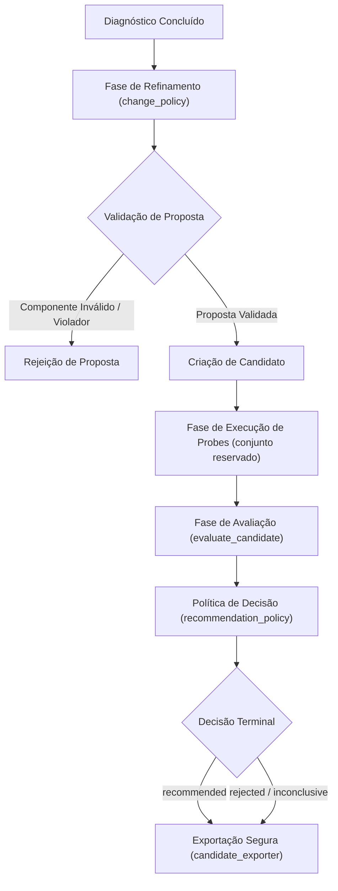

# Refinamento de Candidatos e Política de Avaliação

O **Refinamento de Candidatos e Política de Avaliação** define o pipeline de otimização iterativa, validação cega em amostragem reservada (*held-out set*) e tomada de decisão formal sobre a promoção de novas versões de agentes de IA no Harness Lab.

Este fluxo assegura que qualquer alteração proposta para um agente — como modificações em prompts de sistema, diretrizes de ferramentas ou configurações de parâmetros — seja rigorosamente avaliada contra o [Framework Harness2 e Metodologia de Avaliação](../concepts/harness2-framework.md) e o [Particionamento de Casos e Diagnóstico de Falhas](case-partitioning-diagnosis.md), prevenindo regressões, violações de segurança (*data leakage* e exposição de segredos) e sobreajuste (*overfitting*).

---

## 1. Visão Geral da Arquitetura e Ciclo de Avaliação

O ciclo de vida de refinamento e avaliação ocorre logo após a etapa de diagnose de falhas no [Ciclo de Vida das Rodadas](../concepts/round-lifecycle.md). Ele abrange quatro estágios fundamentais: **Refinamento**, **Execução de Probes**, **Avaliação de Desempenho** e **Exportação de Artefatos**.


*Fluxo sequencial da proposta de refinamento à decisão terminal e exportação de artefatos.*

---

## 2. Política de Mudanças e Geração de Candidatos (`change_policy.py`)

A criação de propostas de refinamento é governada pelo módulo [`src/harness_lab/application/refinement/change_policy.py`](../../src/harness_lab/application/refinement/change_policy.py). O objetivo principal é garantir que as alterações propostas respeitem a arquitetura do agente e não violem regras imutáveis do domínio.

### 2.1. Estrutura da Proposta de Refinamento
Uma proposta de alteração é representada pelo tipo `RefinementProposal`, que contém o nome do componente a ser modificado e o seu novo conteúdo:
* `component`: O identificador do componente alvo (ex.: `system-prompt`, `tool-guidance`).
* `after`: O novo conteúdo textual proposto para o componente.

### 2.2. Regras de Validação (`validate_proposal`)
Antes de ser convertida em um objeto `Candidate`, a proposta passa pela função `validate_proposal(baseline, proposal, supported_components)`:
1. **Componentes Suportados (`UNSUPPORTED_COMPONENT`)**: A alteração é rejeitada se o `component` não estiver presente na lista de componentes suportados pelo motor de refinamento ou se não existir no snapshot de baseline (`baseline.components`).
2. **Restrições Imutáveis (`IMMUTABLE_CONSTRAINT`)**: O novo conteúdo (`proposal["after"]`) é inspecionado contra a tupla `baseline.immutable_constraints`. Se qualquer substring de restrição imutável for detectada no texto proposto, a proposta é sumariamente rejeitada.

Se a proposta passar por ambos os critérios, `validate_proposal` retorna `None`, sinalizando que a mudança é válida e pode ser empacotada em um `Candidate` associado ao snapshot de baseline e às evidências diagnósticas.

---

## 3. Execução de Probes no Conjunto Reservado (`_ExecuteStage`)

Assim que um candidato válido é construído, o pipeline passa para a execução de probes reservadas no estágio `_ExecuteStage` em [`src/harness_lab/application/rounds/create_round_stages.py`](../../src/harness_lab/application/rounds/create_round_stages.py).

### 3.1. Isolamento Estrito de Dados
Para evitar o contágio entre os casos usados no aprendizado e os casos de teste final, a execução de probes é realizada **estritamente** sobre os identificadores presentes em `partition.reserved_ids`.

### 3.2. Execução Pareada
Para cada `case_id` no conjunto reservado, o sistema executa duas instâncias isoladas do agente:
1. **Execução Baseline**: Executada com a versão de baseline (`baseline.id`).
2. **Execução Candidato**: Executada com o snapshot do candidato (`candidate.snapshot.id`).

As execuções produzem objetos `ExecutionResult`, registrando o status determinístico (`succeeded`, `agent_failed`, `integration_failed`, etc.) e métricas detalhadas (`ExecutionMetrics`: latência em milissegundos, consumo de tokens de entrada e saída, e custo financeiro).

---

## 4. Motor de Avaliação e Coleta de Sinais (`evaluate_candidate.py`)

O módulo [`src/harness_lab/application/evaluation/evaluate_candidate.py`](../../src/harness_lab/application/evaluation/evaluate_candidate.py) realiza a comparação quantitativa entre a execução do baseline e a do candidato.

### 4.1. Garantia de Pré-condição Reservada
A função `evaluate_candidate` valida se todos os casos recebidos em `input_data.cases` pertencem estritamente à tupla `input_data.reserved_case_ids`. Se qualquer caso não reservado for fornecido, a avaliação é interrompida lançando um erro `ValueError("EVALUATION_CASE_NOT_RESERVED")`.

### 4.2. Avaliação no Nível de Caso (`CaseEvaluation`)
Para cada caso reservado, uma estrutura `CaseEvaluation` é computada. Uma regressão individual (`regression = True`) é marcada se **qualquer** uma das seguintes condições for verdadeira:
* `completion_change < 0`: A variação na completude da tarefa foi negativa.
* `not deterministic_passed`: A execução do candidato não obteve status `succeeded`.
* `human_approved is False`: Houve rejeição explícita por revisor humano.
* `len(critical_violations) > 0`: Houve pelo menos uma violação crítica de segurança ou diretiva.

### 4.3. Agregação de Sinais e Métricas Globais
* **Variação Média de Completude (`mean_completion`)**: Média aritmética de `completion_change` entre todos os casos da amostra.
* **Pontuação Agregada (`aggregate_score`)**: Calculada combinando a média de completude com os sinais do juiz LLM (`judge_score`):
  $$\text{aggregate\_score} = \text{mean\_completion} + (\overline{\text{judge\_scores}} \times 0.1)$$
* **Detecção de Alta Variabilidade (`high_variability`)**: Marcada como `True` se a amostra contiver mais de um caso e a diferença entre o maior e o menor `completion_change` for superior a $1.0$.
* **Taxa de Regressão (`regression_rate`)**: Proporção de casos na amostra reservada que apresentaram regressão.
* **Score de Confiança (`confidence`)**:
  $$\text{confidence} = \max\left(0, \min\left(1, \frac{\text{sample\_size}}{\text{minimum\_sample\_size}}\right)\right) \times (\text{1.0 se limitações for vazio senão 0.75})$$

As limitações identificadas (como ausência de sinal do judge LLM, revisão humana incompleta ou alta variabilidade de execução) são registradas no campo `limitations` do `VersionedEvaluationResult`.

---

## 5. Política de Decisão e Recomendação (`recommendation_policy.py`)

A decisão sobre a promoção de um candidato é tomada de forma determinística em [`src/harness_lab/application/evaluation/recommendation_policy.py`](../../src/harness_lab/application/evaluation/recommendation_policy.py) através da função `decide_recommendation`. A política aplica uma verificação em cascata multi-gate com prioridades estritas.

### 5.1. Cascata Multi-Gate de Decisão

<!-- openwiki: mermaid parse failed and this diagram was converted to a text fence so it does not break rendering. Fix the diagram source and restore the mermaid fence. Parser error: Heuristic: an unescaped angle bracket inside a label breaks rendering; rephrase the label. -->
```text
flowchart TD
    Start["Entrada: PolicyInput"] --> Gate1{"Lifecycle Override?"}
    Gate1 -- "Sim" --> DecLifecycle["Decisão: Lifecycle (cancelled / integration_failed / etc.)"]
    Gate1 -- "Não" --> Gate2{"sample_size < minimum_sample_size?"}
    Gate2 -- "Sim" --> DecInsufficient["Decisão: validation_insufficient"]
    Gate2 -- "Não" --> Gate3{"critical_failure é True?"}
    Gate3 -- "Sim" --> DecCritical["Decisão: rejected (Critical Violation)"]
    Gate3 -- "Não" --> Gate4{"deterministic_failure ou human_rejected?"}
    Gate4 -- "Sim" --> DecFailure["Decisão: rejected (Deterministic / Human Policy Failed)"]
    Gate4 -- "Não" --> Gate5{"high_variability é True?"}
    Gate5 -- "Sim" --> DecVariability["Decisão: inconclusive (High Variability)"]
    Gate5 -- "Não" --> Gate6{"regression_rate > max_regression_rate?"}
    Gate6 -- "Sim" --> DecRegression["Decisão: rejected (Per-case Regression Failed)"]
    Gate6 -- "Não" --> Gate7{"aggregate_score >= recommendation_threshold?"}
    Gate7 -- "Sim" --> DecRecommended["Decisão: recommended"]
    Gate7 -- "Não" --> DecInconclusive["Decisão: inconclusive (Below Threshold)"]
```
*Fluxogram da política de recomendação multi-gate.*

### 5.2. Mapeamento de Decisões Terminais (`TerminalDecision`)

| Decisão (`TerminalDecision`) | Condição Disparadora | Justificativa (*Rationale*) |
| :--- | :--- | :--- |
| `cancelled` / `integration_failed` / ... | `lifecycle` não nulo | Interrupção por comando ou falha de infraestrutura. |
| `validation_insufficient` | `sample_size < minimum_sample_size` | Amostra reservada abaixo do tamanho mínimo exigido pelo avaliador. |
| `rejected` | `critical_failure == True` | Presença de violação crítica (ex: exposição de PII/segredos). |
| `rejected` | `deterministic_failure` ou `human_rejected` | Falha em testes determinísticos ou rejeição por revisor humano. |
| `rejected` | `regression_rate > maximum_regression_rate` | Taxa de regressão individual excede o limite máximo permitido. |
| `inconclusive` | `high_variability == True` | Alta variabilidade nos resultados compromete a confiança da medição. |
| `inconclusive` | `aggregate_score < recommendation_threshold` | O ganho medido não atingiu o limiar de melhoria necessário. |
| `recommended` | Passou por todos os portões e `aggregate_score >= recommendation_threshold` | O candidato atendeu a todos os critérios de qualidade e superou o limiar de melhoria. |

---

## 6. Exportação Segura e Redação de Candidatos (`candidate_exporter.py` e `write_artifact.py`)

Quando o candidato conclui a fase de avaliação, seus artefatos e diffs técnicos são exportados para auditoria através do módulo [`src/harness_lab/adapters/export/candidate_exporter.py`](../../src/harness_lab/adapters/export/candidate_exporter.py).

### 6.1. Sanitização e Redação de Segredos
Para prevenir o vazamento de credenciais e dados sensíveis em repositórios de artefatos, o exportador utiliza o utilitário `create_redactor(secret_values)` de [`src/harness_lab/adapters/security/redactor.py`](../../src/harness_lab/adapters/security/redactor.py). Todas as strings contidas no candidato e nos diffs que correspondam a segredos cadastrados são substituídas pelo marcador `[REDACTED]`.

### 6.2. Artefatos Gerados
A função `export_candidate` grava três arquivos no diretório `exports/<agent_id>/<round_id>`:
1. **`candidate.json`** (`application/json`): Representação completa do candidato redigida, contendo o snapshot dos componentes, campos de extensão mantidos e o bloco de metadados `_harnessLab` (`sourceVersions`, `roundId`).
2. **`diff.technical.json`** (`application/json`): Estrutura de diff técnico redigida, mapeando as alterações por componente (`changes`) e versões de origem.
3. **`diff.txt`** (`text/plain`): Resumo em texto simples redigido com o formato `component: expectedEffect`.

### 6.3. Garantias de Persistência e Segura Escrita (`write_artifact.py`)
A gravação física dos arquivos em [`src/harness_lab/adapters/export/write_artifact.py`](../../src/harness_lab/adapters/export/write_artifact.py) segue um rigoroso padrão de segurança operacional:
* **Arquivo Temporário**: O conteúdo é inicialmente gravado em um arquivo temporário (`mkstemp`).
* **Permissões POSIX Restritas**: É aplicada a permissão `0o600` (`os.fchmod`), permitindo leitura e escrita exclusivamente pelo proprietário do processo.
* **Substituição Atômica (`os.replace`)**: Garante que os artefatos não fiquem visíveis de forma parcial ou corrompida durante a gravação.
* **Integridade por Hash SHA-256**: Cada artefato exportado retorna um dicionário contendo o caminho final (`path`), o tipo de mídia (`mediaType`) e o hash digest SHA-256 do conteúdo para verificação de integridade.

---

## 7. Testes e Cobertura de Código

A integridade do pipeline de refinamento, avaliação e exportação é validada pela suíte de testes unitários:

* **Validação de Mudanças**: [`tests/unit/application/refinement/test_change_policy.py`](../../tests/unit/application/refinement/test_change_policy.py) testa a rejeição de componentes não suportados e a identificação de substrings de restrições imutáveis.
* **Avaliação de Candidato e Políticas**: [`tests/unit/application/evaluation/test_evaluation.py`](../../tests/unit/application/evaluation/test_evaluation.py) verifica a combinação de sinais (determinístico, medido, judge e humano), bloqueios por falha crítica, tratamentos de variabilidade, validação do isolamento do conjunto reservado (`EVALUATION_CASE_NOT_RESERVED`) e cálculo da confiança.
* **Exportação Segura e Atômica**: [`tests/unit/adapters/export/test_exporters.py`](../../tests/unit/adapters/export/test_exporters.py) assegura que a exportação redacte segredos corretamente, mantenha campos desacoplados de extensão, utilize permissões POSIX `0o600` e valide o hash SHA-256 dos artefatos.
