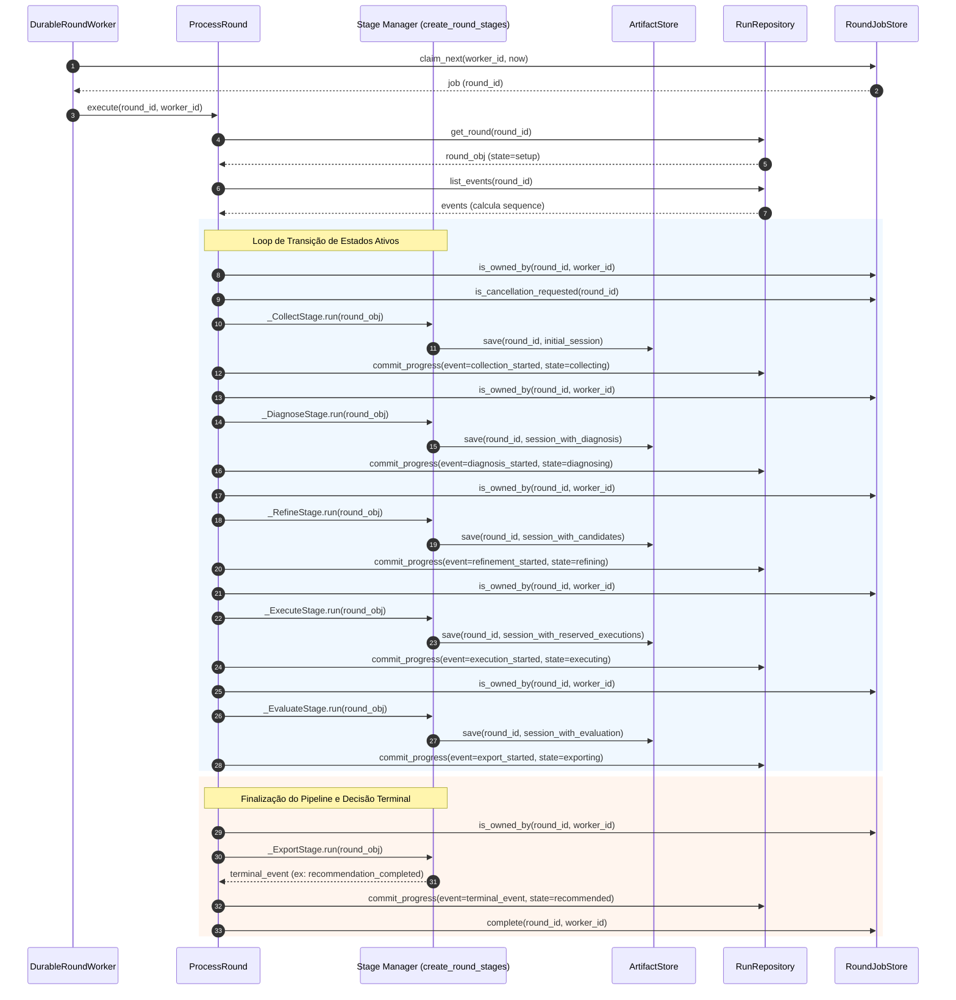

# Fluxo de Execução da Pipeline de Rodadas

O **Fluxo de Execução da Pipeline de Rodadas** define o ciclo de processamento sequencial e reativo através do qual o Harness Lab transforma uma rodada recém-criada (`setup`) em uma avaliação conclusiva com decisões de promoção de agentes (`recommended`, `rejected`, `inconclusive`, etc.).

A orquestração de estados e transições é executada pelo worker distribuído através da classe de aplicação `ProcessRound` em [`src/harness_lab/application/rounds/process_round.py`](../../src/harness_lab/application/rounds/process_round.py), enquanto a lógica de cada estágio é isolada e construída pela fábrica `create_round_stages` em [`src/harness_lab/application/rounds/create_round_stages.py`](../../src/harness_lab/application/rounds/create_round_stages.py). Este pipeline opera em sincronia com o [Ciclo de Vida da Rodada](../concepts/round-lifecycle.md), o [Particionamento de Casos e Diagnóstico de Falhas](case-partitioning-diagnosis.md) e o [Refinamento de Candidatos e Política de Avaliação](evaluation-refinement.md).

---

## 1. Diagrama de Sequência da Execução da Rodada

O diagrama abaixo ilustra o fluxo de chamadas passo a passo entre o worker runtime, o motor `ProcessRound`, os estágios criados por `create_round_stages`, o repositório de artefatos e o banco de dados de progresso.

*Sequência de controle e persistência de progresso durante a execução do pipeline de rodadas.*

---

## 2. Componentes da Arquitetura do Pipeline

A execução do pipeline baseia-se em cinco componentes com responsabilidades estritamente delimitadas:

1. **`ProcessRound`** ([`src/harness_lab/application/rounds/process_round.py`](../../src/harness_lab/application/rounds/process_round.py)):
   Motor principal da máquina de estados. Mantém o loop de transições sequenciais (`setup` -> `collecting` -> `diagnosing` -> `refining` -> `executing` -> `evaluating` -> `exporting`), verifica a posse da concessão (*worker claim*), intercepta solicitações de cancelamento, persiste pontos de checagem (*checkpoints*) e trata exceções operacionais.

2. **`create_round_stages`** ([`src/harness_lab/application/rounds/create_round_stages.py`](../../src/harness_lab/application/rounds/create_round_stages.py)):
   Fábrica responsável por instanciar os executores dos seis estágios operacionais (`_CollectStage`, `_DiagnoseStage`, `_RefineStage`, `_ExecuteStage`, `_EvaluateStage`, `_ExportStage`). Injeta adaptadores externos (coleta de casos/traces, repositório de agentes, motor de refinamento, executor e avaliador).

3. **`ArtifactStore` / `SqliteRoundArtifactStore`** ([`src/harness_lab/adapters/sqlite/round_artifact_store.py`](../../src/harness_lab/adapters/sqlite/round_artifact_store.py)):
   Armazenamento de estado serializável da sessão da rodada (`Session`). Mantém a partição selada, o snapshot baseline, dados de diagnóstico, candidatos gerados, prospecções em amostragem reservada e a estrutura de avaliação.

4. **`RunRepository` / `SqliteRunRepository`** ([`src/harness_lab/adapters/sqlite/run_repository.py`](../../src/harness_lab/adapters/sqlite/run_repository.py)):
   Persiste os eventos de progresso (`RoundProgressEvent`) e checkpoints de estado (`RoundCheckpoint`) através do método atômico `commit_progress`.

5. **`RoundJobStore` / `SqliteRoundJobStore`** ([`src/harness_lab/adapters/sqlite/round_job_store.py`](../../src/harness_lab/adapters/sqlite/round_job_store.py)):
   Gerencia a fila durável de trabalhos no worker, garantindo lease com exclusão mútua por `worker_id` e verificação de cancelamento pendente.

---

## 3. Fluxo Detalhado das Etapas do Pipeline

### 3.1. Fase Inicial: `setup` -> `collecting` (`_CollectStage`)
* **Entrada**: Rodada registrada no banco de dados com estado `setup`.
* **Ações**:
  1. Coleta a lista total de casos de teste disponíveis para o agente/domínio via `cases["collect"](round_obj)`.
  2. Invoca `partition_cases()` com as opções configuradas (`partition_seed`, `minimum_reserved`, `reserved_ratio`).
  3. Sela o manifesto de partição determinístico com `seal_partition_manifest()`, garantindo a separação imutável entre `diagnosis_ids` e `reserved_ids`.
  4. Carrega o snapshot baseline (`HarnessSnapshot`) e as capacidades do agente (`AgentCapabilities`).
  5. Cria a estrutura inicial da sessão (`_empty_session`) e grava no `ArtifactStore`.
* **Transição**: `ProcessRound` emite o evento `collection_started`, movendo o estado para `collecting`.

### 3.2. Fase de Diagnóstico: `collecting` -> `diagnosing` (`_DiagnoseStage`)
* **Entrada**: Sessão gravada com casos e partição selada.
* **Ações**:
  1. Filtra a amostragem de casos pertencentes estritamente a `partition.diagnosis_ids`.
  2. Coleta traces e execuções históricas referentes aos casos de diagnóstico via `traces["collect"](round_obj, trace_input)`.
  3. Invoca `diagnose_executions()`, categorizando falhas em categorias taxonômicas, gerando evidências (`evidence`), achados (`findings`), hipóteses (`hypotheses`) e direções de ação (`actionability`).
  4. Grava a estrutura de diagnóstico atualizada na sessão no `ArtifactStore`.
* **Transição**: `ProcessRound` emite o evento `diagnosis_started`, movendo o estado para `diagnosing`.

### 3.3. Fase de Refinamento: `diagnosing` -> `refining` (`_RefineStage`)
* **Entrada**: Diagnóstico gravado na sessão.
* **Ações**:
  1. Executa `assert_learning_sources(partition, evidence_case_ids)`, validando formalmente que nenhuma evidência utilizada para aprendizado deriva de casos pertencentes a `reserved_ids` (prevenção de *data leakage*).
  2. Constrói a requisição de refinamento (`RefinementRequest`) contendo o baseline, achados, hipóteses, evidências e o limite `max_proposals`.
  3. Chama o motor de refinamento `refinement_engine["refine"]` através do projetor `run_refinement_with_diagnosis_cases`.
  4. Registra os candidatos gerados (`candidates`) e o candidato principal composto (`composed`) na sessão.
* **Transição**: `ProcessRound` emite o evento `refinement_started`, movendo o estado para `refining`.

### 3.4. Fase de Execução de Probes: `refining` -> `executing` (`_ExecuteStage`)
* **Entrada**: Candidato de refinamento gerado na sessão.
* **Ações**:
  1. Itera exclusivamente sobre a amostragem reservada (`partition.reserved_ids`).
  2. Para cada caso reservado, constrói duas requisições de execução idempotentes:
     * Request do Baseline (`kind="baseline"`, idempotency key `{round_id}:{case_id}:reserved:baseline`).
     * Request do Candidato (`kind="candidate"`, idempotency key `{round_id}:{case_id}:reserved:candidate`).
  3. Executa ambas as sondagens em modo isolado através de `executor["execute"]`.
  4. Salva a lista de pares de execução `reservedExecutions` (status, tokens, custo e latência) na sessão.
* **Transição**: `ProcessRound` emite o evento `execution_started`, movendo o estado para `executing`.

### 3.5. Fase de Avaliação: `executing` -> `evaluating` (`_EvaluateStage`)
* **Entrada**: Resultados de execução das sondagens no conjunto reservado.
* **Ações**:
  1. Pares de execução baseline vs candidato são transformados em vetores de sinal (`completion_change`, `cost_change`, `token_change`, `latency_change`, `deterministic_passed`).
  2. Executa `evaluate_candidate()`, aplicando as regras de limite estatístico e tolerância a regressões do avaliador configurado.
  3. Retorna o resultado versionado `VersionedEvaluationResult` contendo a decisão conclusiva (`recommended`, `rejected`, `inconclusive`, `pending_validation` ou `validation_insufficient`).
  4. Grava o bloco `evaluation` na sessão.
* **Transição**: `ProcessRound` emite o evento `evaluation_started`, movendo o estado para `evaluating`.

### 3.6. Fase de Exportação e Encerramento: `evaluating` -> `exporting` -> Estado Terminal (`_ExportStage`)
* **Entrada**: Decisão de avaliação registrada na sessão.
* **Ações**:
  1. `ProcessRound` emite o evento `export_started`, movendo o estado para `exporting`.
  2. `_ExportStage.run` invoca a rotina de exportação `export_round(round_obj, session)` para persistir relatórios e artefatos de candidatura.
  3. Mapeia a decisão avaliativa registrada em `session["evaluation"]["decision"]` para o evento terminal correspondente através de `terminal_event_for_decision`:
     * `recommended` -> `recommendation_completed`
     * `rejected` -> `rejection_completed`
     * `inconclusive` -> `evaluation_inconclusive`
     * `pending_validation` -> `validation_pending`
     * `validation_insufficient` -> `validation_insufficient`
  4. `ProcessRound` grava o evento terminal no repositório, movendo a rodada para seu estado imutável final, e marca o job como concluído em `RoundJobStore.complete`.
* **Transição Terminal**: O ciclo da rodada é finalizado e a FSM encerra a sua execução.

---

## 4. Resiliência, Concorrência e Invariantes

### 4.1. Garantia de Posse da Concessão (*Claim Lock*)
Antes de invocar cada estágio e antes de emitir qualquer evento de progresso, `ProcessRound` executa a verificação `_ensure_owned(round_id, worker_id)`. Se o lease do job no `RoundJobStore` expirar ou for reassignado a outro worker, a exceção `RuntimeError("ROUND_CLAIM_LOST")` é lançada. O worker atual encerra a execução imediatamente sem sobrescrever o estado nem marcar o job como concluído.

### 4.2. Tratamento de Cancelamento Reativo
A cada iteração do loop, `ProcessRound` consulta `is_cancellation_requested(round_id)`. Se uma solicitação de cancelamento for detectada:
1. `ProcessRound` emite imediatamente o evento `cancel_requested`.
2. A FSM transiciona a rodada para o estado terminal `cancelled`.
3. O trabalho é removido da fila com `jobs.complete()`.

### 4.3. Recuperação de Falhas de Integração
Se ocorrer qualquer exceção não prevista durante a execução de um estágio (ex.: falha de rede ou timeout de API externa):
1. A exceção é capturada no bloco `try...except` em `ProcessRound`.
2. O worker confirma a posse com `_ensure_owned`.
3. O evento `integration_failed` é emitido, levando o estado da rodada para `integration_failed`.
4. O job é marcado como concluído para evitar loops infinitos de retentativas descontroladas.

### 4.4. Recuperação Pós-Crash na Fase de Exportação (`recovering_export`)
Se um worker sofrer um crash exatamente após emitir o evento `export_started` (deixando a rodada no estado ativo `exporting`), um novo worker que assumir o job detectará que `round_obj.state == "exporting"`. 

Em vez de reinicializar o pipeline a partir de `setup`, `ProcessRound` aciona a rotina de recuperação `_ExportStage.get_completion_event(round_obj)`. Esta consulta o bloco `evaluation` já persistido no `ArtifactStore` e determina o evento terminal correto, permitindo que a rodada seja finalizada com segurança e idêntica integridade.

---

## 5. Testes de Integração e Validação

O fluxo completo da pipeline de rodadas é validado pela suíte de testes de integração em [`tests/integration/test_complete_round.py`](../../tests/integration/test_complete_round.py).

O teste `test_complete_round_uses_reserved_cases_for_evaluation_and_persists_decision` simula o runtime do worker end-to-end (`create_round_worker_runtime`), cobrindo:
* A criação de uma rodada no estado `setup`.
* O enfileiramento e processamento sequencial através de `runtime.tick()`.
* A verificação de que os testes de avaliação utilizaram rigorosamente os IDs do conjunto reservado (`reserved_ids`).
* A persistência da decisão terminal `recommended` no banco SQLite e no repositório de artefatos.

---

## 6. Páginas Relacionadas e Referências

* [Ciclo de Vida da Rodada (Round)](../concepts/round-lifecycle.md): Especificação formal da máquina de estados e regras de transição do objeto `Round`.
* [Particionamento de Casos e Diagnóstico de Falhas](case-partitioning-diagnosis.md): Algoritmos de divisão determinística de amostragem e taxonomia de diagnose.
* [Refinamento de Candidatos e Política de Avaliação](evaluation-refinement.md): Regras para geração de candidatos e políticas de recomendação.
* [Modelo de Domínio](../architecture/domain-model.md): Entidades, agregados e tipos imutáveis do Harness Lab.
* [Runtime do Worker](../operations/worker-runtime.md): Operação durável da fila de trabalhos e mecanismo de heartbeat/polling dos workers.
